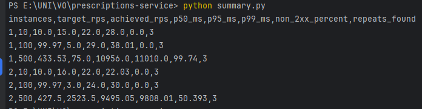
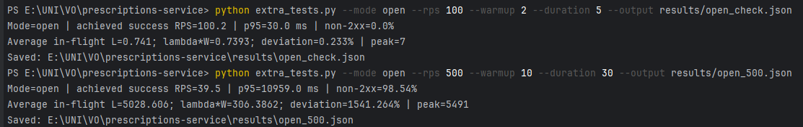
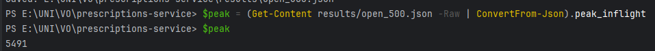
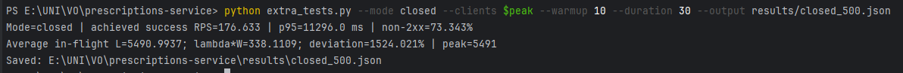

# Лабораторна робота № 1. Проєктування і розгортання CRUD-сервісу

**Дисципліна:** Високопродуктивні розподілені обчислювальні системи  
**Варіант:** 6 — призначення препарату (`/prescriptions`)  
**Виконала:** Герасимчук Дарія
**Група:** ЗК-61мп  
**Стенд:** FastAPI, PostgreSQL 16, Nginx, Docker Compose  

## 1. Мета роботи

Набути практичних навичок проєктування та реалізації REST API із CRUD-операціями, організації збереження даних у PostgreSQL, контейнеризації Docker, налаштування балансування запитів між репліками сервісу та експериментального оцінювання пропускної здатності й затримки.

## 2. Постановка задачі й архітектура

Для варіанта 6 реалізовано ресурс призначення препарату. Обов'язкові поля: код пацієнта, препарат, доза, одиниці вимірювання, кратність приймання за добу, дата початку, тривалість у днях. Фільтрація виконується за назвою препарату. Валідація обмежує кратність діапазоном **1–6**, тривалість — **1–180** днів.

Запити з клієнта надходять до Nginx на порт **8080**, далі переадресовуються до одного або двох інстансів FastAPI (`web:8000`). Обидва вебінстанси звертаються до спільної PostgreSQL через внутрішню мережу Compose. База даних використовує іменований том `postgres_data`.

### 2.1. Програмне середовище та запуск

Використано Python 3.12, Docker, Docker Compose, Git. Стенд запускається командою:

```powershell
docker compose up -d --build --scale web=1
```

Перехід до двох реплік:

```powershell
docker compose up -d --scale web=2
```


### 2.2. Схема таблиці prescriptions

Структура таблиці prescriptions відповідає ORM-моделі SQLAlchemy, використаній у FastAPI. Ідентифікатор `id` є первинним ключем і створюється базою даних.

| Поле | Тип PostgreSQL / ORM | Обов'язковість | Призначення |
|---|---|---|---|
| `id` | `BIGINT`, primary key | Так | Унікальний ідентифікатор; індекс PK |
| `patient_code` | `VARCHAR(50)` | Так | Знеособлений код пацієнта |
| `drug` | `VARCHAR(200)` | Так | Назва препарату; використовується у фільтрі |
| `dose` | `NUMERIC(10,3)` | Так | Точне десяткове значення дози |
| `unit` | `VARCHAR(30)` | Так | Одиниця дози, наприклад mg |
| `frequency_per_day` | `INTEGER` | Так | Кратність приймання (1–6) |
| `start_date` | `DATE` | Так | Дата початку лікування |
| `duration_days` | `INTEGER` | Так | Тривалість (1–180 днів) |

NUMERIC(10,3) обрано, щоб уникнути похибок двійкового представлення дози; `DATE` відповідає календарній даті, а `VARCHAR` обмежує довжину тексту. Фільтрація назви препарату реалізована порівнянням `lower(drug)`; за первинним ключем `id` реалізовано адресний доступ до запису.

### 2.3. Контракт REST API

| Метод | Маршрут | Тіло запиту | Відповідь | HTTP-коди |
|---|---|---|---|---|
| POST | `/prescriptions` | Усі сім полів без `id` | Створений запис з `id` | 201, 400 для невалідних даних |
| GET | `/prescriptions` | Немає; `limit`, `offset`, `drug` в URL | `{"items": [...], "total": N}` | 200, 400 для невалідних параметрів |
| GET | `/prescriptions/{id}` | Немає | Один запис | 200, 404 |
| PUT | `/prescriptions/{id}` | Повний набір семи полів | Оновлений запис | 200, 400, 404 |
| DELETE | `/prescriptions/{id}` | Немає | Порожня відповідь | 204, 404 |
| GET | `/healthz` | Немає | `{"status": "ok"}` | 200, 503 за недоступності БД |

Список має `limit=20` за замовчуванням, найбільше `limit=100`; `offset` починається з нуля. Фільтр `drug` не залежить від регістру, але перевіряє **точну** назву. Заміна PUT повна, не часткова.

У застосунку передбачено обробку некоректних даних із кодом HTTP 400. Початкові експерименти виявили HTTP 500 для частини невалідних запитів, що стало підставою для додаткової перевірки серіалізації помилок валідації.

## 3. Перевірка функціональності CRUD

### 3.1. Swagger та створення запису

У Swagger (`http://localhost:8080/docs`) доступні маршрути роботи з ресурсом. Створення через `POST /prescriptions` повертає **201 Created** і тіло створеного об'єкта.


### 3.2. Отримання даних та фільтрація

За допомогою `GET /prescriptions/{id}` перевірено повернення окремого запису з кодом **200**. Для списку `GET /prescriptions` продемонстровано результат до застосування фільтра та після запиту з параметром `drug`.


### 3.3. Оновлення та видалення

Метод `PUT` замінює значення усіх полів існуючого запису. Метод `DELETE` спочатку повертає **204**, а повторне видалення того самого ідентифікатора — **404**, що відповідає умові.


### 3.4. Перевірка валідації

Вхідні дані перевіряються схемою Pydantic. Значення `frequency_per_day` обмежено інтервалом від 1 до 6, а `duration_days` — від 1 до 180. Некоректні значення відхиляються з кодом HTTP **400 Bad Request** і детальним описом причини. Обробник `RequestValidationError` використовує `jsonable_encoder(exc.errors())` для перетворення повідомлень перевірки у відповідь JSON.

| Параметр | Тестове значення | Результат |
|---|---:|---|
| `frequency_per_day` | 0 | HTTP 400, значення менше допустимого |
| `duration_days` | 0 | HTTP 400, значення менше допустимого |
| `duration_days` | 181 | HTTP 400, значення перевищує максимум 180 |

На наведених скріншотах POST також містить додаткове поле `id`, тому Pydantic одночасно повідомляє про заборонене поле (`extra_forbidden`). Визначення валідаційного обмеження кожного цільового поля залишається окремо видимим у полі `detail`.


## 4. Персистентність PostgreSQL

Звичайний `docker compose down` зупиняє контейнери та мережу, але не видаляє іменований том. Після повторного `up` раніше створені записи залишилися доступними через GET. Команда `docker compose down -v` видаляє і том, тому після нового запуску дані були відсутні.


## 5. Підготовка навантаження

Скрипт `seed.py` надіслав 100 POST-запитів, перевірив записи та зберіг отримані ідентифікатори у `results/ids.json`. Власний генератор `load_test.py` тестував `GET /prescriptions/{id}` з реальними ідентифікаторами. Інтенсивності: **10, 100, 500 RPS**; прогрів **10 с**; інтервал вимірювання **30 с**; **три повтори** кожної конфігурації. Порівнювалися один і два вебінстанси.

```powershell
python seed.py
python load_test.py --rps 100 --warmup 10 --duration 30 --output results/web1_100_1.json
python summary.py
```

Приклад результату одного тесту з одним інстансом на 100 RPS: 3000 виконаних у межах вимірювання запитів, p50 = **5 мс**, p95 = **29 мс**, p99 ≈ **36 мс**, 0% не-2xx.


Умови вимірювання: генератор навантаження та контейнери Docker працювали на одному комп'ютері, тому використовували спільні обчислювальні ресурси. Це могло впливати на отримані результати продуктивності.

### 5.1. Підсумкова таблиця навантажувальних тестів

У таблиці наведено медіанні значення результатів трьох повторів для кожної конфігурації навантаження.

| Web-інстанси | Target RPS | Achieved RPS | p50, мс | p95, мс | p99, мс | Non-2xx, % | Повторів |
|---:|---:|---:|---:|---:|---:|---:|---:|
| 1 | 10 | 10.00 | 15.0 | 22.0 | 28.00 | 0.000 | 3 |
| 1 | 100 | 99.97 | 5.0 | 29.0 | 38.01 | 0.000 | 3 |
| 1 | 500 | 433.53 | 75.0 | 10956.0 | 11010.00 | 99.740 | 3 |
| 2 | 10 | 10.00 | 16.0 | 22.0 | 22.03 | 0.000 | 3 |
| 2 | 100 | 99.97 | 3.0 | 24.0 | 30.00 | 0.000 | 3 |
| 2 | 500 | 427.50 | 2523.5 | 9495.05 | 9808.01 | 50.393 | 3 |



### 5.2. Аналіз поведінки при навантаженні

На 10 і 100 RPS обидві конфігурації досягли заданої інтенсивності й не мали не-2xx відповідей. Для 100 RPS другий інстанс зменшив p95 із **29** до **24 мс**, p99 — із **38.01** до **30 мс**.

На 500 RPS обидві конфігурації **не підтримували заявленого рівня без значних втрат**. При одному інстансі медіанна частка не-2xx становила **99.74%**, а при двох — **50.393%**. Хоча формально `achieved_rps` становив 433.53 та 427.50, ці значення **не можна інтерпретувати як RPS успішних HTTP-відповідей**: до завершених запитів могли зараховуватися винятки з'єднання. Потрібна окрема метрика успішних 2xx/с.

Після додавання другого інстанса частка неуспішних запитів на 500 RPS суттєво зменшилася, але безпомилкового обслуговування цільової інтенсивності все одно не досягнуто. Спільними для реплік залишилися PostgreSQL, Nginx і ресурси фізичного хоста.

## 6. Балансування навантаження Nginx

У конфігурації Nginx використано Docker DNS `127.0.0.11`, динамічне визначення `web:8000` і запис поля `$upstream_addr` у журнал. Для 100 пробних запитів `/healthz` одержано розподіл **48/52** між двома адресами контейнерів: `172.18.0.5:8000` та `172.18.0.3:8000`. Отже, підтверджено, що обидві репліки обробляють трафік; це не доводить ідеально рівномірного балансування для кожного навантаження.


## 7. Розрахунки продуктивності

### 7.1. Прискорення та метрика Карпа—Флатта

Формули для двох інстансів:

\[
S = \frac{X(2)}{X(1)}, \qquad e = \frac{1/S-0.5}{0.5}.
\]

При **100 RPS**:

- `X(1) = 99.97 RPS`, `X(2) = 99.97 RPS`;
- `S = 99.97 / 99.97 = 1.000`;
- `e = (1/1 - 0.5)/0.5 = 1.000`.

Це **не доказ**, що застосунок повністю послідовний: при низькому навантаженні обидва режими обмежені швидкістю **надходження** запитів (100 RPS), а не досягнутою межею продуктивності. Тому Карпа—Флатта в цій точці не слід фізично інтерпретувати як частку послідовної роботи.

Розрахунок для навантаження 500 RPS:

- `X(1) = 433.53`, `X(2) = 427.50`;
- `S = 427.50 / 433.53 ≈ 0.9861`;
- `e = (1/0.9861 - 0.5)/0.5 ≈ 1.0282`.

Через велику кількість помилок отримані показники не відображають реального прискорення обробки успішних запитів. Для точнішої оцінки необхідно порівнювати кількість успішних HTTP-відповідей за секунду. Для надійного висновку потрібна пропускна здатність успішних 2xx відповідей за однаковим режимом та коректне відокремлення помилок генератора.

### 7.2. Закон Літтла

Закон Літтла для стаціонарної системи у сталому режимі формулюється як:

\[
L = \lambda W,
\]

де `L` — середня кількість запитів у системі, `λ` — інтенсивність завершення запитів за секунду, `W` — середній час перебування запиту в системі. Для перевірки використано скрипт `extra_tests.py` з незалежним накопиченням площі під графіком кількості активних запитів і вимірюванням тривалості запитів.

Під час контрольного прогону відкритого типу з навантаженням **100 RPS**, двосекундним прогрівом і п'ятьма секундами вимірювання отримано:

| Показник | Результат |
|---|---:|
| Фактичний успішний RPS | 100,2 |
| p95 | 30,0 мс |
| Не-2xx | 0% |
| Виміряна середня кількість активних запитів `L` | 0,741 |
| `λW`, виведене генератором | 0,7393 |
| Розбіжність | 0,233% |
| Пікова кількість активних запитів | 7 |

Отримана розбіжність 0,233% свідчить про узгодженість вимірювань у контрольному тесті зі сталим невеликим навантаженням.



### 7.3. Порівняння відкритого та закритого контурів

Відкрита модель формує нові запити із заданою інтенсивністю незалежно від завершення попередніх. Закрита модель використовує фіксовану кількість клієнтів, кожен з яких надсилає наступний запит тільки після завершення поточного.

Для порівняння використано один вебконтейнер. У відкритому режимі задано 500 RPS; після 10 секунд прогріву проведено 30 секунд вимірювань. Максимальна кількість незавершених запитів у цьому експерименті становила **5491**; цю величину застосовано як кількість клієнтів закритого тесту.

| Показник | Відкритий контур | Закритий контур |
|---|---:|---:|
| Цільова інтенсивність | 500 RPS | Не задається; 5491 клієнт |
| Успішні завершення за секунду | 39,5 | 176,633 |
| p95, мс | 10 959 | 11 296 |
| Частка не-2xx, % | 98,54 | 73,343 |
| Максимальна одночасність | 5491 | 5491 |
| Середня одночасність | 5028,606 | 5490,993 |

При відкритому навантаженні 500 RPS система втрачала більшість запитів. Закрита модель з 5491 клієнтом дала більшу інтенсивність успішних завершень і меншу частку невдалих запитів, проте p95 лишалася понад 11 секунд. В обох тестах спостерігалися великі затримки та значна кількість помилок. Це свідчить про перевантаження системи при вибраних параметрах.

Для цих двох експериментів скрипт також вивів формальне порівняння `L` та `λW`: **1541,264%** у відкритому і **1524,021%** у закритому режимі. Ці значення не використовуються як перевірка закону Літтла: `L` інтегрується для всіх активних запитів (включно з невдалими), тоді як `λW` у програмі розраховується лише для успішних завершень. За такої частки помилок ці множини не відповідають одна одній, а режим не є стаціонарним. Коректна перевірка наведена у пункті 7.2.






## 8. Додаткова вимога варіанта № 6 — ротація Docker-логів

У кожному з трьох сервісів (`db`, `web`, `nginx`) налаштовано драйвер `json-file` із параметрами:

```yaml
logging:
  driver: json-file
  options:
    max-size: "10m"
    max-file: "3"
```

Після `docker compose up -d --force-recreate --scale web=2` команда `docker inspect` повернула для обох реплік `{"Type":"json-file","Config":{"max-file":"3","max-size":"10m"}}`. Показано роботу журналів `docker compose logs --tail=30 web`. Також отримано шляхи `/var/lib/docker/containers/.../*-json.log` для двох вебконтейнерів.


Команда `docker inspect` підтвердила застосування обмежень, а `LogPath` показала розміщення журналів. Після додаткових навантажувальних тестів обсяг текстового виводу `docker logs` одного працюючого вебконтейнера становив **1,036 МіБ**. Це оцінка обсягу отриманого тексту, а не фізичного розміру всіх лог-файлів на диску. Налаштування межі 10 МБ і трьох файлів перевірено через `docker inspect`; фактична ротація не була потрібна для цього обсягу.


## 9. Контрольний журнал виконаних перевірок

| Дія | Спостереження / код |
|---|---|
| Запуск середовища `docker compose up` | Контейнери запущені |
| Відкриття `/docs` | Swagger доступний |
| `POST /prescriptions` | HTTP 201, створення запису |
| `GET /prescriptions` | HTTP 200, список/пагінація |
| `GET /prescriptions/{id}` | HTTP 200, отримання запису |
| `GET /prescriptions?drug=...` | HTTP 200, фільтр |
| `PUT /prescriptions/{id}` | HTTP 200, запис оновлено |
| `DELETE /prescriptions/{id}` | HTTP 204 |
| Повторний `DELETE` | HTTP 404 |
| Невалідні POST-запити | HTTP 400 із повідомленнями про некоректні поля |
| `down` → `up` | Дані в томі збережено |
| `down -v` → `up` | Попередні дані видалено |
| `GET /healthz` | `{"status":"ok"}` |
| Розподіл між 2 `web` | 48 і 52 запити |
| Docker logging | `json-file`, 10m, 3 файли — налаштовано |

## 10. Образ, швидкість старту та конфігурації

Для розгортання застосунку використано образи PostgreSQL 16 та Nginx на базі Alpine Linux. Вебсервіс зібрано на основі Python 3.12-slim. Для нього встановлено обмеження ресурсів: 1 CPU та 512 МБ оперативної пам'яті. 

Розмір образу `prescriptions-web:lab1` за результатом `docker image inspect` становив **257,19 МіБ** (268,6 млн байтів за десятковим округленням); Docker CLI окремо показав `DISK USAGE 270 MB` та `CONTENT SIZE 63.8 MB`. Для оцінювання використано саме поле `.Size` із `docker image inspect`, без змішування з поняттями дискового використання та контентного розміру.


Час холодного запуску виміряно тричі шляхом `docker compose down -v`, нового запуску Compose з однією вебреплікою й очікування першої відповіді HTTP 200 від `/healthz`. Отримано **8,45 с**, **8,44 с** та **8,11 с**. Медіана становить **8,44 с**, середнє — **8,33 с**. Вимір включає запуск PostgreSQL, очікування його готовності та старт Nginx і FastAPI.

### 10.1. Конфігурація Docker Compose

```yaml
services:
  db:
    image: postgres:16
    environment:
      POSTGRES_USER: ${POSTGRES_USER:?required}
      POSTGRES_PASSWORD: ${POSTGRES_PASSWORD:?required}
      POSTGRES_DB: ${POSTGRES_DB:?required}
    volumes:
      - postgres_data:/var/lib/postgresql/data
      - ./db/init.sql:/docker-entrypoint-initdb.d/init.sql:ro
    healthcheck:
      test:
        - CMD-SHELL
        - pg_isready -U "$$POSTGRES_USER" -d "$$POSTGRES_DB"
      interval: 5s
      timeout: 3s
      retries: 20
    networks:
      - internal
    logging:
      driver: json-file
      options:
        max-size: "10m"
        max-file: "3"

  web:
    build: .
    image: prescriptions-web:lab1
    environment:
      POSTGRES_USER: ${POSTGRES_USER:?required}
      POSTGRES_PASSWORD: ${POSTGRES_PASSWORD:?required}
      POSTGRES_DB: ${POSTGRES_DB:?required}
      DB_HOST: db
    depends_on:
      db:
        condition: service_healthy
    expose:
      - "8000"
    cpus: 1.0
    mem_limit: 512m
    networks:
      - internal
    logging:
      driver: json-file
      options:
        max-size: "10m"
        max-file: "3"

  nginx:
    image: nginx:stable-alpine
    ports:
      - "8080:80"
    volumes:
      - ./nginx/nginx.conf:/etc/nginx/nginx.conf:ro
    depends_on:
      - web
    networks:
      - internal
    logging:
      driver: json-file
      options:
        max-size: "10m"
        max-file: "3"

volumes:
  postgres_data:

networks:
  internal:
    driver: bridge
```


## 11. Розглянуті архітектурні рішення

Під час реалізації було обрано такі підходи:

| Рішення, яке не використовувалося | Прийнятий підхід | Обґрунтування |
|---|---|---|
| Зберігання записів лише в пам’яті вебпроцесу | Спільна PostgreSQL з Docker-томом | Дані доступні після перезапуску вебреплік; обидві репліки працюють з однією базою |
| Пряме відкриття порту кожного вебконтейнера назовні | Єдина точка входу Nginx | Єдиний URL на порту 8080, маршрутизація між репліками через Docker DNS |
| Ручне призначення ідентифікаторів та окремий ID у POST | Первинний ключ у PostgreSQL, ID повертається у відповіді | Уникає конфліктів при одночасних запитах і приховує службове поле від клієнтської схеми створення |

## 12. Висновки

У ході виконання лабораторної роботи було реалізовано контейнеризований CRUD-сервіс призначень препаратів із PostgreSQL та Nginx. Підтверджено доступність CRUD-маршрутів, персистентність даних у Docker-томі, роботу двох вебреплік і розподіл 100 пробних запитів у пропорції 48/52.

На рівнях 10 та 100 RPS система працювала без HTTP-помилок. При 500 RPS виникла істотна деградація, високі затримки та значна кількість невдалих запитів. Друга репліка зменшила частку помилок, але не забезпечила стійкого обслуговування заданої інтенсивності; спільні Nginx, PostgreSQL і ресурси хоста могли впливати на результат.

Підтверджено налаштування обмеження журналів Docker за розміром і кількістю файлів; обсяг тексту журналів одного контейнера після тестів становив 1,036 МіБ. Розмір образу — 257,19 МіБ, медіанний час холодного запуску — 8,44 с. Контрольний прогін на 100 RPS узгодився із законом Літтла з розбіжністю 0,233%. При перевантаженні порівняно відкритий та закритий контури; обидва показали значні затримки й високий відсоток невдалих запитів.

