# Лабораторна робота № 2. Метрики сервісу і межа масштабованості

**Дисципліна:** Високопродуктивні розподілені обчислювальні системи  
**Варіант:** 6  
**Основа:** CRUD-сервіс призначень препаратів `/prescriptions`, реалізований у лабораторній роботі № 1.  
**Початкові експерименти:** 24.10.2026.
**Виправлений аудит і повторні експерименти:** 04–05.11.2026.

## 1. Мета і постановка завдання

Інструментувати FastAPI-сервіс у форматі Prometheus, дослідити ступінчасте навантаження на 1, 2, 3 і 4 екземплярах, визначити межу генератора, оцінити пропускну здатність і перевірити додаткову метрику М4 — частку серверних запитів, виконаних не довше визначеного порогу.

Варіант задає **DB_POOL_SIZE = 15** з'єднань на web-екземпляр, гістограму **Г2** з межами 2, 5, 10, 20, 50, 100, 200, 500, 1000 і 2000 мс та метрику **М4**. Кожен web-контейнер має обмеження **1 CPU і 512 MiB**.

## 2. Стенд і реалізація

Стенд складається з FastAPI, SQLAlchemy, PostgreSQL 16, Nginx, Prometheus v3.2.1 і Docker Compose. Nginx приймає зовнішні запити на порту 8080, а Prometheus опитує web-екземпляри кожні 5 с. Масштабування виконується через `docker compose up -d --scale web=N`.

Під час виправленого аудиту генератор переведено на облік когорт фактично запущених спроб, додано окремий лічильник надсилання HTTP-заголовків у сокет, усунено відкидання запитів за `max_pending` та знято ліміт `TCPConnector(limit=100)`. Endpoint `/metrics` зроблено асинхронним, щоб Prometheus не втрачав телеметрію при насиченні threadpool. Для необроблених винятків HTTP 500 формується з `X-Pod`, тому заголовок наявний також у помилковій відповіді.

Сервіс експортує:

- `http_requests_total{method,path,code}` — завершені HTTP-запити;
- `http_request_duration_seconds_bucket{method,path,le}` — серверну гістограму Г2;
- `http_requests_in_progress` — запити в обробці;
- `process_cpu_seconds_total` — процесорний час процесу.

Під час виправленого повтору `docker info` зафіксував **12 CPU**, **7,446 GiB Total Memory** і Docker Server **29.8.2**. Первинний запис міститься в `results/lab2/corrected_docker_info.json`. Значення CPU стосується повтору 04–05.11.2026 і не приписується заднім числом початковому прогону 24.10.2026.

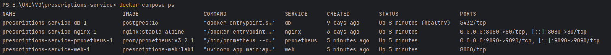

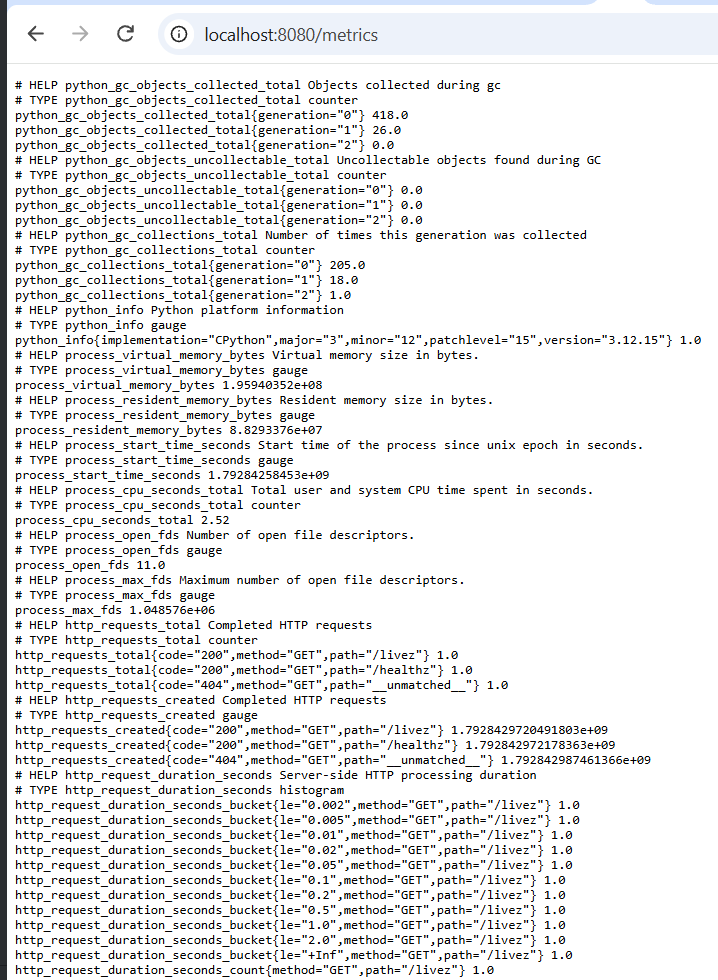

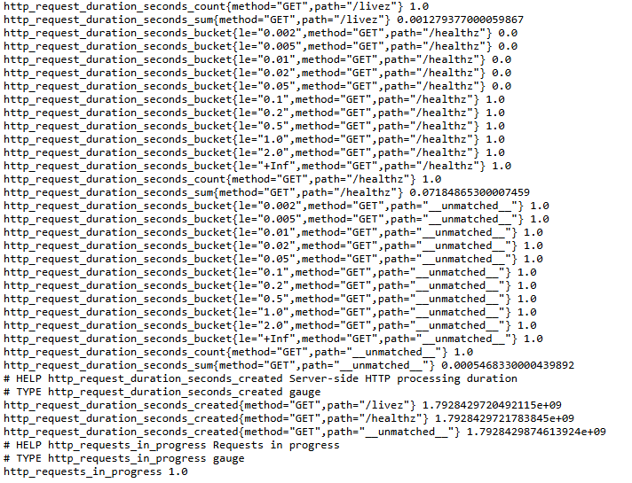

## 3. Перевірка моніторингу і балансування

Для одного екземпляра Prometheus показав 1/1 ціль `UP`, для чотирьох — 4/4. Серія відповідей із різними значеннями `X-Pod` підтвердила маршрутизацію між чотирма web-контейнерами. Окремий тест через `TestClient` отримав HTTP 500 із непорожнім `X-Pod`, що перевіряє виправлення для необробленого винятку.

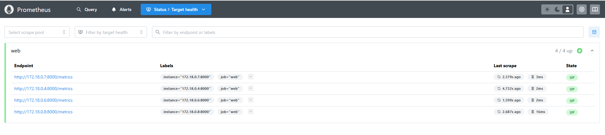

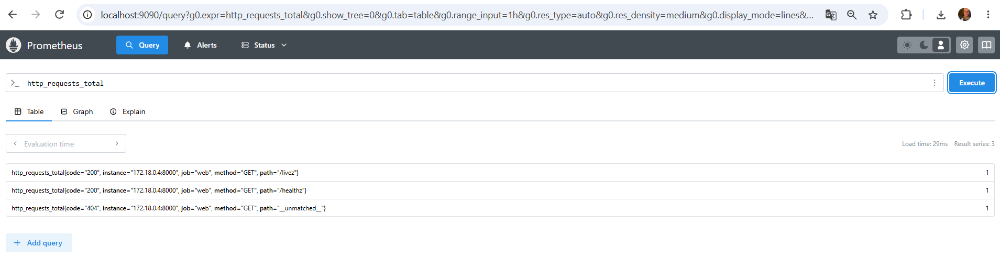

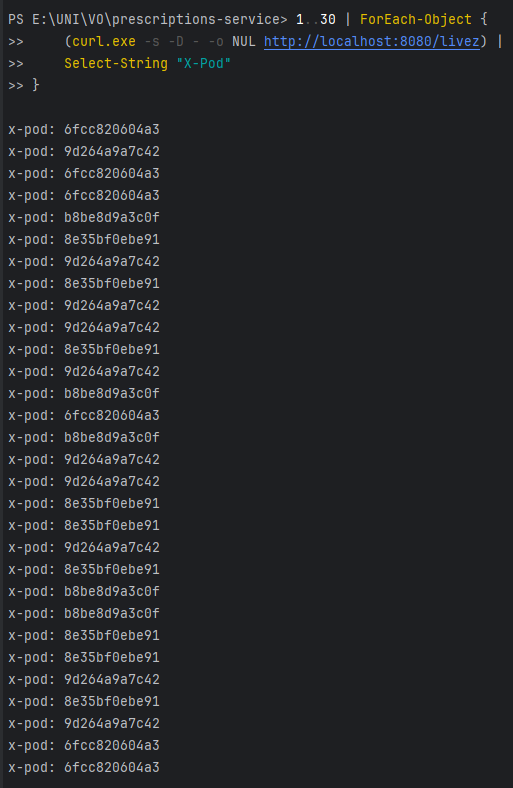

## 4. Контрольна підготовка бази і пулів

Скрипт `seed.py --count 100 --output results/ids.json` створив і перевірив 100 записів. `GET /prescriptions/101` та `/healthz` повернули HTTP 200. PostgreSQL мав `max_connections=100`; чотири прикладні пули по 15 можуть одночасно використати до 60 з'єднань.

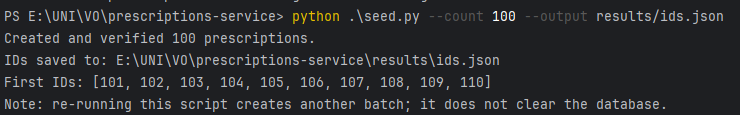

## 5. Коректне завершення SIGTERM

Виправлений тест виконував **50 RPS** до `/prescriptions/{id}` протягом 25 с на двох web-екземплярах. На 10-й секунді команда `docker stop prescriptions-service-web-2` надіслала SIGTERM одному екземпляру. На відміну від старого тесту `/livez`, кожний запит звертався до PostgreSQL.

| Показник | Результат |
|---|---:|
| Усього запитів | 1250 |
| Запити у контрольному вікні [5;15) с | 500 |
| Non-2xx або мережеві помилки у вікні | **0** |
| Return code `docker stop` | **0** |
| ExitCode контейнера | **0** |

Первинні дані: `results/lab2/corrected_shutdown.csv` і `corrected_shutdown_meta.json`. Отже, Nginx перенаправив запити до другого екземпляра, а зупинений контейнер завершився штатно без втрат у контрольному вікні.

## 6. Методика виправленого ступінчастого навантаження

Основний профіль залишено без зміни: 10 с прогріву при 200 RPS, далі сходинки 200, 400, 600, ... RPS по 20 с; для підсумку беруться останні 15 с. Тайм-аут запиту — 5 с. Прогін зупиняється після двох послідовних сходинок, де завершений 2xx RPS менший за 90% цілі. Перед кожним N stateless web-контейнери примусово перестворювалися, тому незавершені запити попередньої конфігурації не могли потрапити до наступного прогону.

Облік генератора розділяє:

- `scheduled_rps` — заплановані моменти запуску;
- `sent_rps` — фактично запущені HTTP-спроби, які є знаменником частки помилок;
- `wire_sent_rps` — подія `on_request_headers_sent`, тобто заголовки реально передано транспортові;
- `success_rps` — відповіді 2xx, згруповані за секундою завершення.

Запити більше не відкидаються за кількістю pending-задач. `TCPConnector(limit=0)` не створює прихованої черги зі 100 з'єднань. Після дренування задач кожен результат прив'язується до секунди запуску своєї спроби. Тайм-аут зберігається в окремій колонці та одночасно входить до `http_non2xx`:

\[
http\_non2xx = HTTP\ status\ non2xx + timeouts.
\]

Частка невдалих спроб:

\[
error\_fraction=\frac{HTTP\ status\ non2xx+timeouts+connection\ errors}{sent\ requests\ у\ 15\text{-секундному вікні}}.
\]

### 6.1. Межа генератора G

Контрольний `/noop` обслуговується Nginx без FastAPI і БД. До 1000 RPS `sent_rps`, `wire_sent_rps` і завершений 2xx RPS збігаються. На наступних двох сходинках доставка заголовків і завершення різко падають.

| Ціль, RPS | Sent, RPS | Wire sent, RPS | 2xx, RPS | Тайм-аути | Частка помилок |
|---:|---:|---:|---:|---:|---:|
| 800 | 800,067 | 800,067 | 799,933 | 0 | 0,0000% |
| 1000 | 1000,400 | 1000,400 | **1000,133** | 0 | 0,0000% |
| 1200 | 971,333 | 568,867 | 471,133 | 6701 | 45,9918% |
| 1400 | 1031,000 | 229,667 | 113,467 | 13763 | 88,9945% |

Отже, **G = 1000,133 RPS**, а `0,9G = 900,120 RPS`. Дві сходинки 1200 і 1400 RPS послідовно нижчі за 90% цілі, тому критерій зупинки виконано.

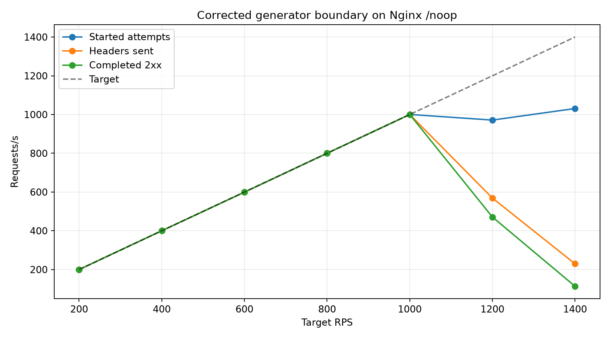

## 7. Виправлена серія для N=1–4

### 7.1. Основний профіль із кроком 200 RPS

| N | Ціль, RPS | Sent, RPS | Wire sent, RPS | 2xx, RPS | p99 клієнта, мс | http_non2xx | Connection errors | Частка помилок |
|---:|---:|---:|---:|---:|---:|---:|---:|---:|
| 1 | 200 | 199,800 | 199,800 | 16,133 | 5999,000 | 2997 | 0 | 100,0000% |
| 1 | 400 | 400,000 | 400,000 | 0,000 | 6004,000 | 4924 | 1076 | 100,0000% |
| 2 | 200 | 199,800 | 199,800 | 200,000 | 40,020 | 0 | 0 | 0,0000% |
| 2 | 400 | 400,000 | 399,200 | 88,867 | 5988,500 | 4832 | 821 | 94,2167% |
| 2 | 600 | 511,267 | 435,933 | 0,000 | 8278,667 | 6635 | 1034 | 100,0000% |
| 3 | 200 | 200,267 | 200,267 | 200,000 | 31,000 | 0 | 0 | 0,0000% |
| 3 | 400 | 400,000 | 400,000 | 399,200 | 107,500 | 0 | 0 | 0,0000% |
| 3 | 600 | 559,933 | 430,000 | 158,933 | 8391,283 | 5596 | 799 | 76,1400% |
| 3 | 800 | 729,533 | 227,200 | 68,333 | 12592,525 | 9566 | 0 | 87,4166% |
| 4 | 200 | 200,000 | 200,000 | 200,000 | 30,000 | 0 | 0 | 0,0000% |
| 4 | 400 | 400,467 | 400,467 | 399,600 | 53,570 | 0 | 0 | 0,0000% |
| 4 | 600 | 583,733 | 562,333 | 393,733 | 5791,803 | 397 | 1363 | 20,1005% |
| 4 | 800 | 766,667 | 427,533 | 297,733 | 11260,390 | 7308 | 0 | 63,5478% |

Усі лічильники остаточні: їх перераховано після drain pending-задач. `http_non2xx` уже включає тайм-аути, а частка помилок додатково включає `connection_errors`. За критерієм `success ≥ 0,9·target` і `CV ≤ 10%` основний профіль не має стійкої точки для N=1; для N=2, 3 і 4 останні стійкі точки становлять відповідно 200,000, 399,200 і 399,600 RPS.

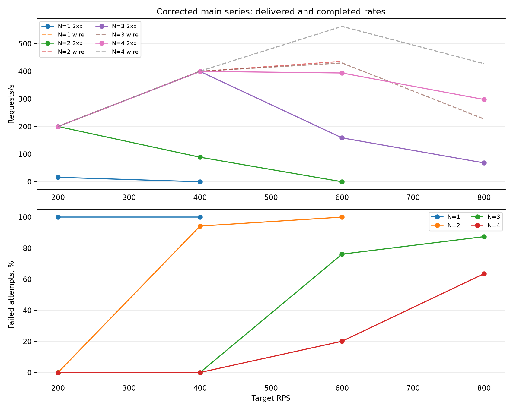

### 7.2. Уточнювальна серія з кроком 25 RPS

Щоб не ділити на нуль при USL і не вигадувати X(1), виконано ще одну однакову для N=1–4 серію: 10 с прогріву, сходинки 25, 50, 75, ... RPS по 20 с, останні 15 с для підсумку. Перед кожним N web-контейнери перестворено.

| N | Ціль, RPS | X(N), RPS | SD, RPS | CV | p99 клієнта, мс | Частка помилок |
|---:|---:|---:|---:|---:|---:|---:|
| 1 | 150 | **155,533** | 15,068 | 9,6880% | 593,133 | 0,0000% |
| 2 | 325 | **313,733** | 12,025 | 3,8329% | 4022,642 | 0,0000% |
| 3 | 450 | **437,600** | 31,080 | 7,1024% | 2209,568 | 0,0000% |
| 4 | 475 | **474,533** | 9,570 | 2,0167% | 92,341 | 0,0000% |

Це останні точки, що одночасно задовольняють обидва критерії. Великі p99 для N=2 і N=3 не приховано: методика X(N) обмежує throughput і CV, але не задає окремої SLO-межі затримки.

### 7.3. Аудит початкової серії

Початкові `webN_final_*` залишено як історичні первинні файли, але вони не використовуються для нового висновку: генератор пропускав запити при 3000 pending і мав `TCPConnector(limit=100)`. За формулою рецензента частки помилок на старих пікових сходинках дорівнюють:

| N | Старе X(N), RPS | Невдалі спроби | Надіслано за 15 с | Частка |
|---:|---:|---:|---:|---:|
| 1 | 171,133 | 0 | 3000 | 0,0000% |
| 2 | 328,200 | 0 | 6000 | 0,0000% |
| 3 | 424,933 | 398 | 8679 | **4,5858%** |
| 4 | 539,667 | 0 | 9000 | 0,0000% |

Розрахунок збережено у `historical_peak_error_fractions.csv`. Також виправлено описку: для N=2 при 200 RPS сирий `web2_final_steps.csv` містить p99 **41,010 мс**, а не 41,610 мс.

### 7.4. Prometheus на пікових вікнах основного профілю

| N | Спостережений максимум 2xx, RPS | CPU на web-екземпляр, % одного ядра | In-progress на web-екземпляр |
|---:|---:|---:|---:|
| 1 | 16,133 | 100,60 | 1075,33 |
| 2 | 200,000 | 43,19 | 1,17 |
| 3 | 399,200 | 63,79 | 2,78 |
| 4 | 399,600 | 47,23 | 1,92 |

N=1 уже на 200 RPS насичує одне ядро і накопичує понад тисячу in-progress на екземпляр. Для N=2–4 останні стійкі пікові вікна проходять без помилок; CPU розподіляється між репліками.

## 8. Оцінка USL

Для уточнювальної серії обчислено `C(N)=X(N)/X(1)` і виконано МНК для

\[
C(N)=\frac{N}{1+\sigma(N-1)+\kappa N(N-1)}.
\]

Спостережені `C(N)` дорівнюють 1,0000; 2,0171; 2,8136; 3,0510. Необмежений fit дає `σ=-0,146550`, `κ=0,062177`, `N*≈4,29`. Від'ємне σ є ознакою надлінійних точок N=2 і не має фізичного змісту як «від'ємна серіалізація». Тому додатково наведено невід'ємний fit: `σ=0`, `κ=0,022354`, `N*≈6,69`. Він має більшу похибку (`SSE=0,009267` проти `0,000396`) і не доводить відсутність серіалізації; це обмежена модель лише за чотирма виміряними точками. Старі коефіцієнти відкликано.

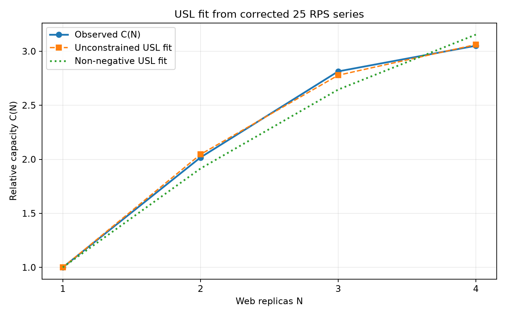

## 9. Серверний p99 і вирівняні часові ряди

Серверний p99 отримано з `increase(http_request_duration_seconds_bucket{job="web",method="GET",path="/prescriptions/{id}"}[15s])`. Значення `≥2000` означає потрапляння p99 у `+Inf`: гістограма Г2 дає лише нижню межу.

| N | Ціль, RPS | p99 сервера, мс | Бакет / статус | M4 при T=2000 мс |
|---:|---:|---:|---|---:|
| 1 | 200 | ≥2000 | `+Inf` | 0,0000% |
| 1 | 400 | ≥2000 | `+Inf` | 0,0000% |
| 2 | 200 | 19,774 | 10–20 | 100,0000% |
| 2 | 400 | ≥2000 | `+Inf` | 0,0000% |
| 2 | 600 | ≥2000 | `+Inf` | 0,0000% |
| 3 | 200 | 18,782 | 10–20 | 100,0000% |
| 3 | 400 | 121,608 | 100–200 | 100,0000% |
| 3 | 600 | ≥2000 | `+Inf` | 1,0384% |
| 3 | 800 | 1979,831 | 1000–2000 | 100,0000% |
| 4 | 200 | 9,962 | 5–10 | 100,0000% |
| 4 | 400 | 46,173 | 20–50 | 100,0000% |
| 4 | 600 | ≥2000 | `+Inf` | 17,5336% |
| 4 | 800 | ≥2000 | `+Inf` | 88,2952% |

Клієнтський p99 відраховується від запланованого моменту й включає очікування поза серверним обробником; серверний p99 охоплює лише запити, що потрапили до сервера. Рисунки 11 і 12 мають спільну вісь часу для трьох панелей: клієнтський/серверний p99; заданий і завершений RPS; поекземплярні RPS, CPU та in-progress. Дані отримано через Prometheus `query_range`.

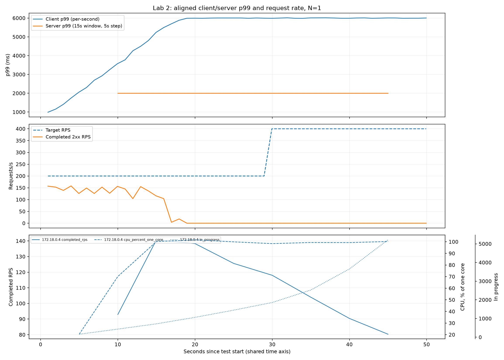

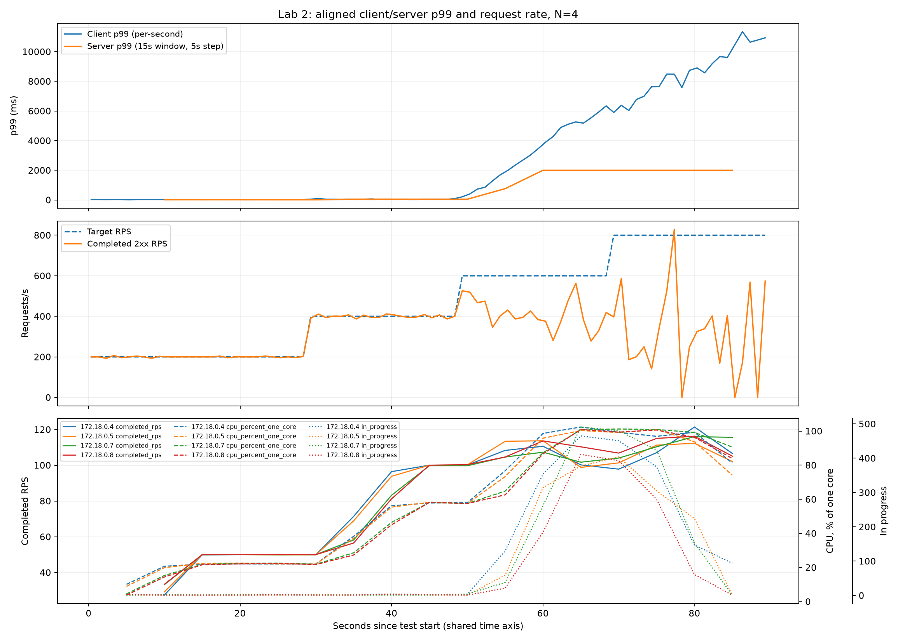

## 10. Додаткова метрика М4

На першій сходинці N=1 серверний p99 лежить вище останньої скінченної межі Г2, тому **T=2000 мс**. М4 — це відношення приросту накопичувального бакета `le="2.0"` до приросту `+Inf` для того самого маршруту й 15-секундного вікна. Результати містяться в таблиці розділу 9 і `corrected_server_metrics.csv`; значення обмежено фізичним діапазоном [0;1].

## 11. Додаткова метрика ресурсів і спільний обмежувач

Окремий чистий повтор N=4 збирав `docker stats` і ресурси Python-генератора одночасно. Його X(4)=399,600 RPS на сходинці 400 RPS. Для останніх 15 с отримано по 5 семплів кожного контейнера та 15 семплів генератора.

| Компонент | Середній CPU, ядер |
|---|---:|
| Чотири web разом | 2,58412 |
| PostgreSQL | 0,27130 |
| Nginx | 0,14910 |
| Prometheus | 0,00056 |
| Генератор | 0,14547 |
| **Разом** | **3,15055** |
| CPU Docker VM | **12,00000** |

CPU генератора у тому самому 15-секундному вікні становив **14,547% одного ядра**, середня RAM — **39,621 MiB**. Сумарно використано 3,15055/12 = **26,25%** CPU Docker VM. Отже, ні CPU хоста, ні генератор не є спільним обмежувачем. Насичення проявляється у спільному контурі **Nginx → web → PostgreSQL**: після стійких точок зростають in-progress, p99, timeout і connection errors. Наявні метрики не дають чесно приписати причинність одному компоненту без окремого факторного експерименту.

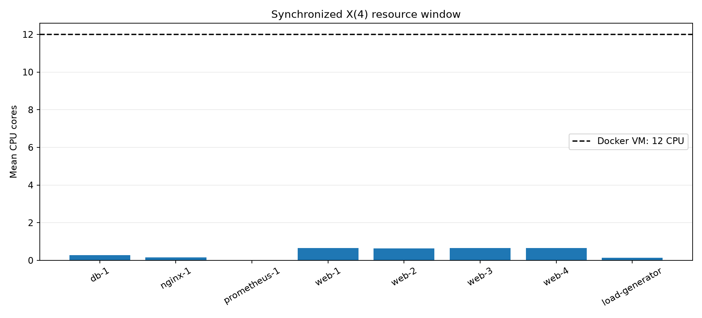

## 12. Висновки

У генераторі тайм-аути входять до `http_non2xx`, відкидання за `max_pending` відсутнє, `TCPConnector` необмежений, а фактичне надсилання заголовків вимірюється окремо. Межа `/noop` становить **G=1000,133 RPS**. Чистий основний профіль підтвердив стійкі точки 200,000 RPS для N=2, 399,200 для N=3 і 399,600 для N=4; для N=1 крок 200 RPS надто грубий. Уточнювальний профіль дав X(1..4)=155,533; 313,733; 437,600; 474,533 RPS і дозволив прозоро оцінити USL із застереженням щодо від'ємного необмеженого σ.

Частка невдалих спроб наведена для кожної сходинки; у старій піковій точці N=3 вона становила 4,5858%, а не 0%. Graceful-shutdown тест на БД-маршруті завершився без помилок у контрольному вікні та з ExitCode=0. Синхронне ресурсне вікно використало 3,15055 із 12 CPU, тому CPU VM і генератор відхилено як спільні обмежувачі; точне розділення внеску Nginx, web-черг і PostgreSQL потребує окремого експерименту.

## 13. Використання генеративної моделі і перевірка

Генеративну модель використано як допоміжний інструмент для ревізії коду генератора, побудови запитів PromQL та перевірки узгодженості таблиць. Усі числові твердження у виправлених розділах походять із нових CSV/JSON, Prometheus `query_range`, `docker info` або показаних формул. Команди запускалися локально; відсутні часові ряди не заповнювалися припущеннями.

## 14. Дані і відтворюваність

Основні виправлення:

- `corrected_noop_final_*` — межа G;
- `corrected_web1_*`–`corrected_web4_*` — основна серія;
- `corrected_fine_web1_*`–`corrected_fine_web4_*`, `corrected_fine_peak_summary.csv`, `corrected_usl_*` — уточнювальна серія й USL;
- `corrected_server_metrics.*` і `corrected_aligned_*` — p99, М4 та query_range;
- `corrected_web4_sync_*` і `corrected_resource_summary.csv` — синхронні ресурси;
- `corrected_shutdown*` — SIGTERM на `/prescriptions/{id}`;
- `historical_peak_error_fractions.csv` — виправлений розрахунок старої таблиці;
- `results/lab2/corrections_audit.md` — відповідність усім зауваженням.

Файли `corrected_noop_*` без суфікса `final` та ранні `corrected_web1_initial_*`/`corrected_web1_pre_async_metrics_*` є проміжними діагностичними повторами. Вони збережені, але не використовуються в таблицях і висновках цього звіту.

Відтворення у консолі:

```powershell
Set-Location E:\UNI\VO\prescriptions-service
python -m pip install -r requirements-lab2.txt
docker compose up -d --build --scale web=1

python step_load_test.py --mode noop --url http://localhost:8080 `
  --output results/lab2/corrected_noop_final --max-rps 4000

foreach ($n in 1..4) {
  docker compose up -d --no-deps --force-recreate --scale web=$n web
  Start-Sleep -Seconds 30
  python step_load_test.py --mode web --url http://localhost:8080 `
    --ids results/ids.json --output "results/lab2/corrected_web$n" `
    --max-steps 8 --max-rps 1600
}

foreach ($n in 1..4) {
  docker compose up -d --no-deps --force-recreate --scale web=$n web
  Start-Sleep -Seconds 30
  python step_load_test.py --mode web --url http://localhost:8080 `
    --ids results/ids.json --output "results/lab2/corrected_fine_web$n" `
    --start-rps 25 --step-rps 25 --max-steps 24 --max-rps 600
}

docker compose up -d --no-deps --force-recreate --scale web=4 web
Start-Sleep -Seconds 30
python finish_lab2.py capture-web4 --prefix corrected_web4_sync

python finish_lab2.py historical --series-template 'corrected_web{n}' `
  --output-prefix corrected_server_metrics
python complete_lab2_metrics.py --series-template 'corrected_web{n}' `
  --output-prefix corrected --figure-n1 41_corrected_aligned_n1.png `
  --figure-n4 42_corrected_aligned_n4.png
python analyze_lab2_corrections.py
```

