# Лабораторна робота № 2. Метрики сервісу і межа масштабованості

**Дисципліна:** Високопродуктивні розподілені обчислювальні системи  
**Варіант:** 6  
**Основа:** CRUD-сервіс призначень препаратів `/prescriptions`, реалізований у лабораторній роботі № 1.  
**Дата експериментів:** 24.10.2026.

## 1. Мета і постановка завдання

Інструментувати наявний FastAPI-сервіс у форматі Prometheus, дослідити роботу при ступінчастому навантаженні на 1, 2, 3 і 4 екземплярах, оцінити пропускну здатність і масштабованість та перевірити додаткову метрику М4 — частку серверних запитів, виконаних не довше визначеного порогу.

Варіант задає: **DB_POOL_SIZE = 15** з'єднань на один web-екземпляр, **Г2** (бакети 2, 5, 10, 20, 50, 100, 200, 500, 1000, 2000 мс), **М4**. Обмеження кожного web-контейнера з лабораторної № 1: **1 CPU і 512 МБ**. Для чотирьох екземплярів загальний максимальний розмір прикладних пулів дорівнює `4 × 15 = 60` з'єднань.

## 2. Стенд і внесені зміни

Збережено попередню схему PostgreSQL та всі CRUD-маршрути. Стек: **FastAPI + SQLAlchemy + PostgreSQL 16 + Nginx + Docker Compose**. Додано **Prometheus v3.2.1** (порт 9090) із DNS-пошуком web-контейнерів та інтервалом scrape **5 с**. Nginx є зовнішньою точкою входу на порт 8080, PostgreSQL доступний лише у мережі Docker. Вебконтейнери запускаються через `--scale web=N` без дублювання описів Compose.

Оновлено `app/main.py` (інструментування middleware, `/metrics`, `/livez`, `X-Pod`, DB_POOL_SIZE), `requirements.txt` (бібліотека Prometheus), `Dockerfile` (тайм-аут коректної зупинки), `docker-compose.yml` (Prometheus, пул і grace-period), `nginx/nginx.conf` (Nginx `/noop`, upstream і повторні спроби під час зупинки). Додано `prometheus/prometheus.yml`, `step_load_test.py`, `shutdown_probe.py`. Існуючий `REPORT.md` не змінювався.

Сервіс реєструє:

- `http_requests_total{method,path,code}` — лічильник запитів; шлях позначається шаблоном, а не реальним ID;
- `http_request_duration_seconds_bucket{method,path,le}` — накопичувальні бакети серверної тривалості у секундах;
- `http_requests_in_progress` — gauge запитів в обробці;
- стандартні метрики процесу, зокрема `process_cpu_seconds_total`.

`GET /livez` перевіряє процес без БД; `GET /healthz` перевіряє підключення до PostgreSQL; `GET /metrics` експортує числові ряди. `X-Pod` дозволяє розрізняти екземпляри. У `/metrics` також присутній автоматичний бакет `+Inf`.

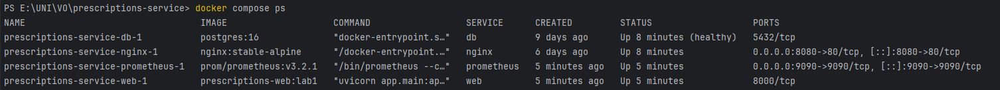

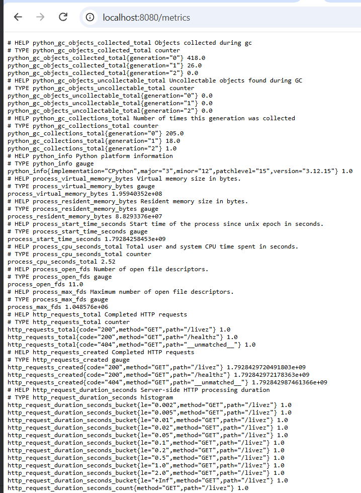

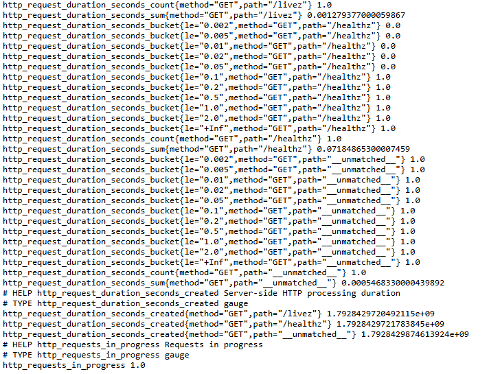

## 3. Перевірка моніторингу і балансування

Для одного екземпляра сторінка Prometheus Targets показала **1/1 UP**, для чотирьох — **4/4 UP**. Здійснено запит `http_requests_total`, що повернув лічильники для `/livez`, `/healthz` і незіставленого маршруту. `http_requests_in_progress` повертав значення **1** під час опитування, що може відповідати поточному запиту до `/metrics`.

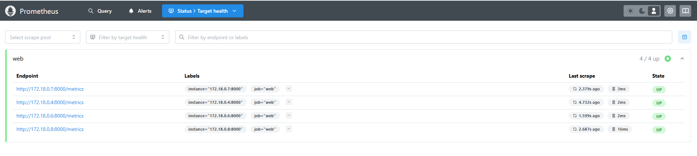

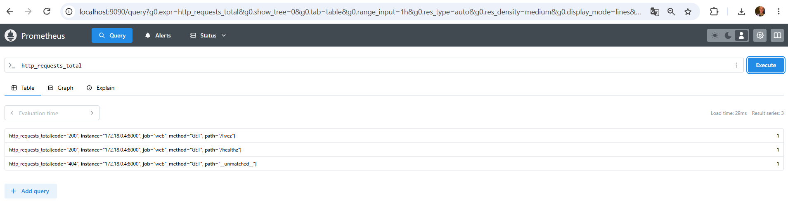

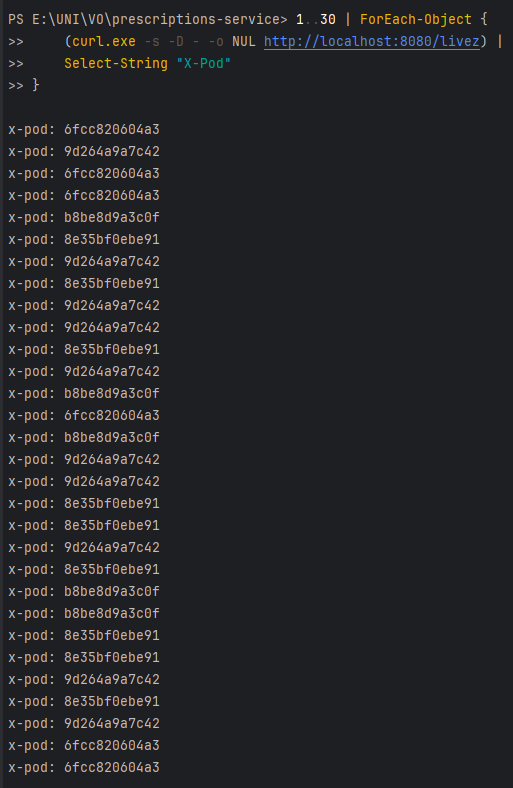

Ці результати підтверджують видимість усіх чотирьох екземплярів і факт розподілу HTTP-запитів, але самі собою не доводять **рівномірності** розподілу під навантаженням.

## 4. Контрольна підготовка бази і пулів

Скрипт `seed.py --count 100 --output results/ids.json` створив і перевірив **100** записів. Отримані ідентифікатори **101–200**, усі вони лежать в окремому списку для GET-тестів. Перевірка `GET /prescriptions/101` повернула HTTP **200** та коректний запис. Перевірка `/healthz` також повернула HTTP **200**.

`SHOW max_connections` у PostgreSQL повернув **100**; `pg_stat_activity` у стані спокою показав **36** підключень усього, з яких **30 idle** і **1 active** для робочої бази (решта — інші службові підключення). Це узгоджується з двома налаштованими пулами по 15, однак не виключає черг на рівні застосунку під навантаженням.

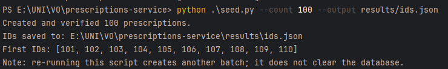

## 5. Коректне завершення SIGTERM

Виконано експеримент з двома web-екземплярами та зупинкою `web-2` під навантаженням **50 запитів/с** на `/livez`. До корекції Nginx під час контрольних 10 секунд спостерігалося **24** помилки/тайм-аути, хоча `ExitCode=0`. Після переходу до динамічного upstream, retry та коригування маршрутизації повторний тест показав:

| Показник | Початковий прогін | Після виправлення |
|---|---:|---:|
| Усього запитів | 1250 | 1250 |
| Запити в контрольному вікні 5–15 с | 498 | 501 |
| Відповіді не 2xx / помилки | 24 | **0** |
| Код завершення контейнера | 0 | **0** |

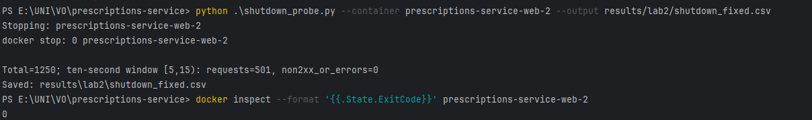

Отже, обидві умови коректної зупинки в контрольному тесті виконані.

## 6. Методика ступінчастого навантаження

Генератор Python/aiohttp використовує відкритий контур: моменти запуску запитів плануються наперед і не очікують завершення попереднього запиту. Він виконує **10 с прогріву при 200 RPS**, потім сходинки **200, 400, 600, ... RPS** тривалістю **20 с**. Для кожної сходинки агрегуються останні **15 с**; перші **5 с** не враховують як перехідні. Тайм-аут запиту: **5 с**. Прогін зупиняється після **двох послідовних** сходинок, де середній успішний RPS менший за `0,9 × заданий`, або при досягненні контрольної верхньої межі.

Результати генератора містять заданий RPS, фактичний `send_rps`, успішний `success_rps`, p50/p95/p99 клієнта, HTTP-помилки, помилки з'єднання і тайм-аути. **Досягнутий RPS** визначався за завершеними HTTP 2xx, а не за кількістю надісланих запитів.

Під час діагностики з'ясовано, що відкриття надто великої кількості TCP-з'єднань викликало різку деградацію. Надалі перевірено налаштування keep-alive upstream Nginx та обмеження кількості TCP-з'єднань генератора. Проміжний тест на N=2 з кроком 50 RPS показав стабільну роботу до **300 RPS**, досягнутий RPS **314,733** при цілі 350 і **277,8** при 400 RPS. Цей прогін має **діагностичний** статус, оскільки його крок відрізняється від методики основної серії.

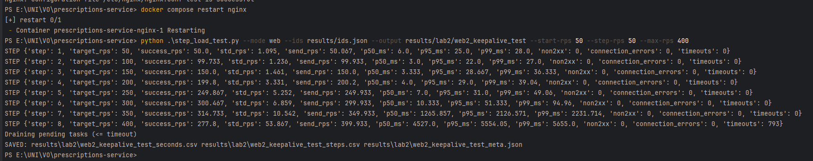

### 6.1. Межа генератора G (без звернень до web)

Ендпоінт `/noop` Nginx повертав HTTP 204 без запиту до FastAPI. Перший прогін зміг обслужити **3001,533 RPS** на сходинці 3000, однак зупинився за обмеженням кількості сходинок і **не підтвердив** стійку межу генератора. Розширений прогін досяг максимуму **2792,667 RPS** при цілі **2800** (SD **90,801 RPS**); при 3000 і 3200 RPS пропускна здатність впала нижче 90% заданої на двох сходинках поспіль. У цьому розширеному прогоні зареєстровано **922** тайм-аути при 3000 та **153** при 3200 RPS. Значення `peak_pending=3000` дорівнює внутрішньому ліміту генератора, тож верхня частина профілю також обмежена ресурсами клієнта.

Для подальших формальних перевірок взято **G = 2792,667 RPS**, `0,9G = 2513,400 RPS`. Розбіжність із першим прогоном відображає мінливість умов і не замовчується.

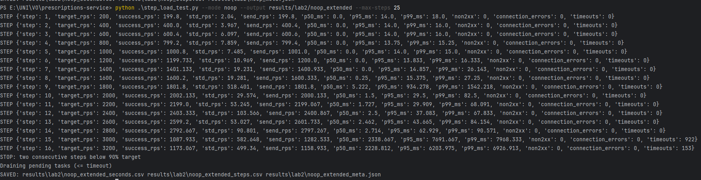

## 7. Результати основної серії для N=1–4

Первинні дані всіх чотирьох прогонів збережено у `results/lab2/web{1,2,3,4}_final_seconds.csv`, `_steps.csv` і `_meta.json`. Наведені нижче значення відповідають результатам генератора.

### 7.1. Усі сходинки

| N | Задано, RPS | Надіслано, RPS | Досягнуто 2xx, RPS | p50 клієнта, мс | p95 клієнта, мс | p99 клієнта, мс | Тайм-аути за обліком генератора |
|---:|---:|---:|---:|---:|---:|---:|---:|
| 1 | 200 | 200,000 | 171,133 | 3512,000 | 4522,700 | 4614,360 | 0 |
| 1 | 400 | 399,600 | 69,933 | 5487,000 | 5834,500 | 5901,850 | 4782 |
| 2 | 200 | 200,000 | 200,000 | 4,000 | 28,050 | 41,610 | 0 |
| 2 | 400 | 400,000 | 328,200 | 2365,500 | 3575,000 | 3784,560 | 0 |
| 2 | 600 | 523,667 | 211,000 | 5374,167 | 5679,333 | 5737,000 | 4739 |
| 3 | 200 | 200,200 | 199,800 | 3,000 | 27,000 | 33,000 | 0 |
| 3 | 400 | 399,933 | 399,600 | 10,000 | 57,675 | 129,570 | 0 |
| 3 | 600 | 578,600 | 424,933 | 3393,667 | 5330,483 | 5486,333 | 398 |
| 3 | 800 | 546,667 | 327,933 | 5353,250 | 5564,500 | 5617,012 | 3577 |
| 4 | 200 | 200,000 | 199,800 | 2,000 | 27,000 | 31,000 | 0 |
| 4 | 400 | 400,000 | 400,333 | 5,500 | 33,400 | 55,500 | 0 |
| 4 | 600 | 600,000 | 539,667 | 1283,333 | 1978,100 | 2081,453 | 0 |
| 4 | 800 | 595,333 | 464,467 | 5142,750 | 5379,775 | 5491,460 | 1492 |

У цих рядках значення `non2xx = 0` і `connection_errors = 0` за виводом скрипта. Тайм-аути рахувалися окремо як помилки виконання запитів. Для p99 більше за 5 с можливий внесок черги планувальника генератора: вимірюється час від **запланованого**, а не фактичного моменту відправлення.

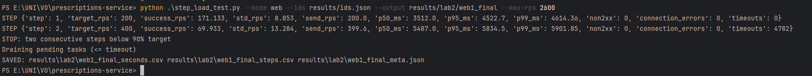

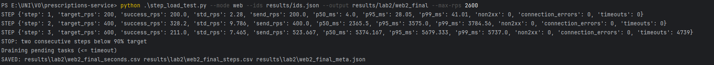

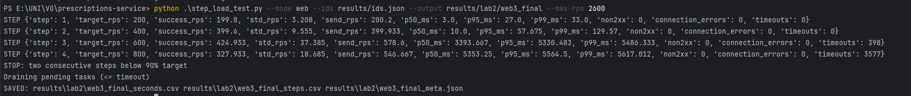

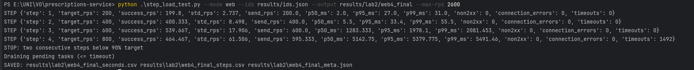

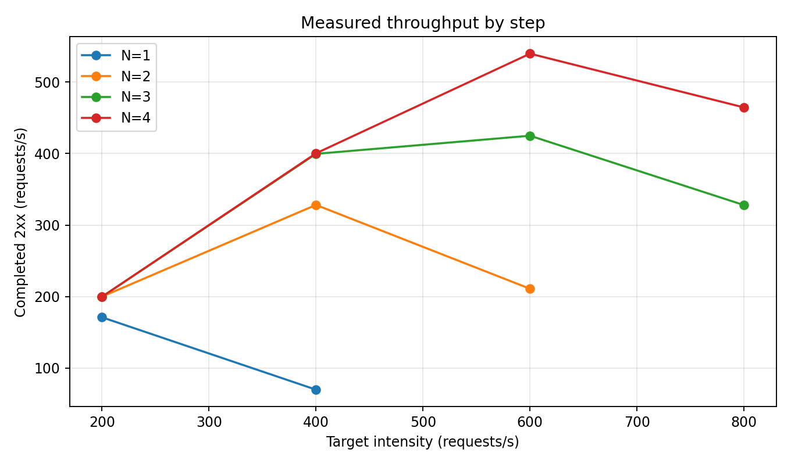

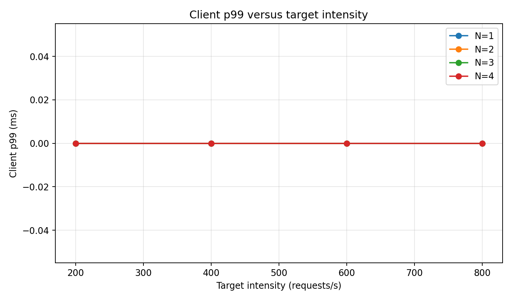

### 7.2. Пропускна здатність і розкид

За методикою `X(N) = max(середній завершений 2xx RPS на сходинці)`, а SD береться на тій самій сходинці.

| N | X(N), RPS | SD посекундного RPS | Сходинка максимального X(N), RPS | p99 клієнта там, мс | X(N) / заданий, % |
|---:|---:|---:|---:|---:|---:|
| 1 | **171,133** | 8,853 | 200 | 4614,360 | 85,57 |
| 2 | **328,200** | 9,786 | 400 | 3784,560 | 82,05 |
| 3 | **424,933** | 37,385 | 600 | 5486,333 | 70,82 |
| 4 | **539,667** | 17,906 | 600 | 2081,453 | 89,94 |

Всі отримані X(N) значно менші за `0,9G=2513,400`, отже за критерієм досягнутої пропускної здатності вони **не обмежені виміряною межею G**. Однак фактична інтенсивність відправлення на високих сходинках (особливо 600–800 RPS) не завжди дорівнювала заданій, тому на інтерпретацію впливає конкуренція генератора із системою й накопичення черги. На N=1 вже перша основна сходинка 200 RPS не досягла заданої інтенсивності. Для уточнення межі проведено додатковий прогін із кроком 25 RPS (див. нижче).

Додатковий прогін N=1 показав максимум 173,467 RPS на сходинці 200 RPS. Це близько до початкового X(1)=171,133 RPS і підтверджує приблизний рівень продуктивності одного екземпляра.

### 7.3. Підсумкова характеристика пікових сходинок

| N | X(N), RPS | p99 клієнта, мс | p99 сервера, мс | Відповіді не 2xx | Зафіксовані тайм-аути на сходинці |
|---:|---:|---:|---:|---:|---:|
| 1 | 171,133 | 4614,360 | 985,557 | 0 | 0 |
| 2 | 328,200 | 3784,560 | 499,466 | 0 | 0 |
| 3 | 424,933 | 5486,333 | 977,999 | 0 | 398 |
| 4 | 539,667 | 2081,453 | 489,591 | 0 | 0 |

Показник `non2xx=0` не означає відсутності невдалих запитів: тайм-аути та скидання з’єднання обліковуються окремо, а частина запитів могла залишатися незавершеною після кінця вимірювального вікна. Без зіставлення за ідентифікаторами запитів не можна надійно обчислити єдину частку всіх невдалих спроб за сходинку. Тому у таблиці наведено окремі лічильники, а не хибний «0% помилок».

Середні CPU та in-progress для N=1–3 саме на пікових сходинках не були збережені окремими числовими рядами. Історичні графіки Prometheus підтверджують їхню динаміку, але не дають підстав вигадувати середні значення. Для N=4 ресурсний зріз на піку наведено у розділі 11 за **повторним** синхронним прогоном; змішувати його з X(4) основної серії не слід.

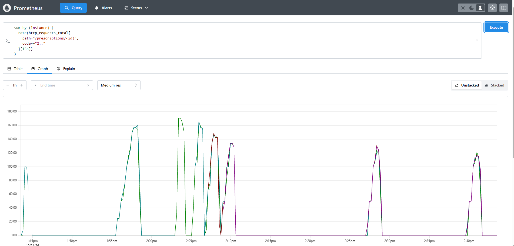

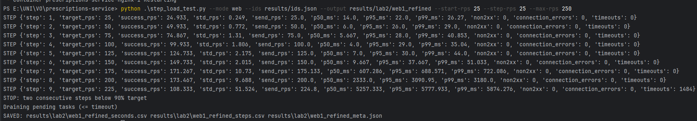

## 8. Оцінка універсального закону масштабованості (USL)

Закон:

\[
X_{model}(N)=\frac{\lambda N}{1+\sigma(N-1)+\kappa N(N-1)},\quad \lambda=X(1)=171{,}133.
\]

Відносна пропускна здатність `C(N)=X(N)/X(1)`:

| N | X(N) | C(N) | y(N)=N/C(N)−1 | u(N)=N−1 | v(N)=N(N−1) |
|---:|---:|---:|---:|---:|---:|
| 1 | 171,133 | 1,000000 | 0 | 0 | 0 |
| 2 | 328,200 | 1,917807 | 0,042858 | 1 | 2 |
| 3 | 424,933 | 2,483057 | 0,208188 | 2 | 6 |
| 4 | 539,667 | 3,153495 | 0,268434 | 3 | 12 |

Оцінюємо без вільного члена, використовуючи N=2,3,4:

\[
y(N)=\sigma u(N)+\kappa v(N).
\]

\[
\begin{aligned}
\sum u^2&=14, & \sum v^2&=184, & \sum uv&=50,\\
\sum uy&\approx1{,}264537, &\sum vy&\approx4{,}556054.
\end{aligned}
\]

\[
\sigma=\frac{(\sum v^2)(\sum uy)-(\sum uv)(\sum vy)}{(\sum u^2)(\sum v^2)-(\sum uv)^2}
\approx\mathbf{0{,}064106}.
\]

\[
\kappa=\frac{(\sum u^2)(\sum vy)-(\sum uv)(\sum uy)}{(\sum u^2)(\sum v^2)-(\sum uv)^2}
\approx\mathbf{0{,}007341}.
\]

Обидва коефіцієнти додатні, тому коригування від'ємних коефіцієнтів не потрібне. За моделлю:

\[
N^*=\sqrt{\frac{1-\sigma}{\kappa}}=
\sqrt{\frac{1-0{,}064106}{0{,}007341}}\approx\mathbf{11{,}29}.
\]

**N* ≈ 11,29 — екстраполяція формули, а не експериментально підтверджена оптимальна кількість контейнерів.** Реально досліджено тільки 1–4 екземпляри, і спільний PostgreSQL, CPU хоста та параметри генератора можуть змінити форму кривої при N>4.

| N | Фактично X(N) | Модель X(N) | Різниця факт − модель |
|---:|---:|---:|---:|
| 1 | 171,133 | 171,133 | 0,000 |
| 2 | 328,200 | 317,269 | +10,931 |
| 3 | 424,933 | 437,957 | −13,024 |
| 4 | 539,667 | 534,619 | +5,048 |

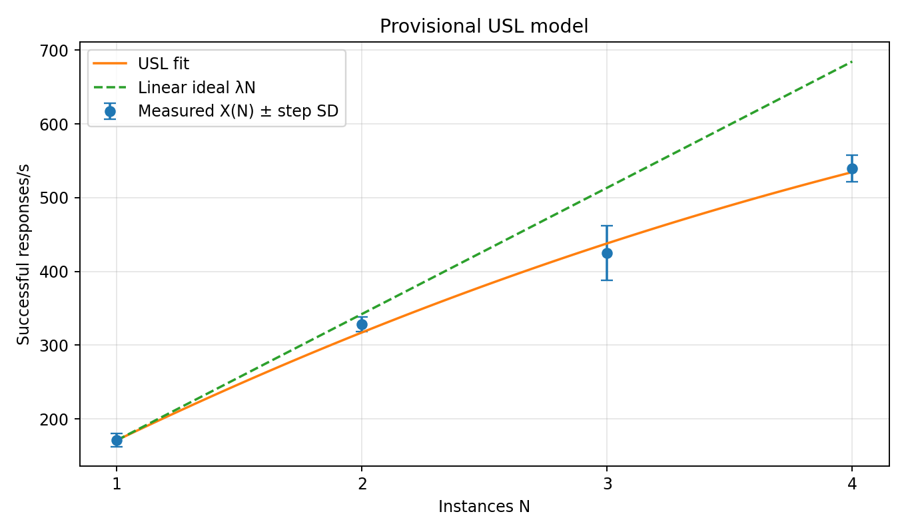

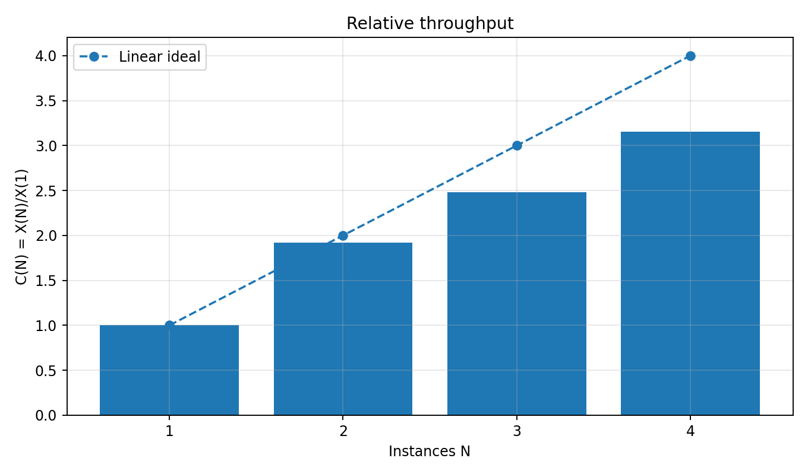

**Обмеження моделі:** USL оцінено за чотирма точками основної серії. Додаткова серія N=1 виявила насичення приблизно на 175–200 RPS, а повторний N=4 — помітний міжпрогонний розкид. Тому N* є модельною екстраполяцією, а не перевіреним оптимумом. Первинні CSV кожного прогону наявні у `results/lab2/`.

## 9. Серверний p99: перевірка за історичними бакетами Prometheus

Історичні значення p99 отримано для **13 сходинок** фінальної серії за даними гістограми Prometheus. Часові вікна узгоджено з початком відповідних прогонів у `_meta.json`, а оцінки виконано за приростами бакетів за 15 секунд. Вимірювання наведено для маршруту `GET /prescriptions/{id}`.

Серверний p99 визначено методом інтерполяції кумулятивних лічильників гістограми Г2, підсумованих за екземплярами. Максимальна похибка відповідає ширині бакета. Збережено числові результати `results/lab2/server_metrics.csv` та `results/lab2/server_metrics.json`.

| N | Сходинка | Задано, RPS | p99 сервера, мс | Бакет, мс | Макс. похибка, мс | М4 (до 1000 мс) |
|---:|---:|---:|---:|---:|---:|---:|
| 1 | 1 | 200 | 985.557 | 500–1000 | 500 | 1.000000 |
| 1 | 2 | 400 | 991.442 | 500–1000 | 500 | 1.000000 |
| 2 | 1 | 200 | 32.222 | 20–50 | 30 | 1.000000 |
| 2 | 2 | 400 | 499.466 | 200–500 | 300 | 1.000000 |
| 2 | 3 | 600 | 622.439 | 500–1000 | 500 | 1.000000 |
| 3 | 1 | 200 | 19.494 | 10–20 | 10 | 1.000000 |
| 3 | 2 | 400 | 151.270 | 100–200 | 100 | 1.000000 |
| 3 | 3 | 600 | 977.999 | 500–1000 | 500 | 1.000000 |
| 3 | 4 | 800 | 489.296 | 200–500 | 300 | 1.000000 |
| 4 | 1 | 200 | 16.553 | 10–20 | 10 | 1.000000 |
| 4 | 2 | 400 | 47.114 | 20–50 | 30 | 1.000000 |
| 4 | 3 | 600 | 489.591 | 200–500 | 300 | 1.000000 |
| 4 | 4 | 800 | 481.266 | 200–500 | 300 | 1.000000 |

Для N=1 на першій сходинці оцінено p99 сервера **985,557 мс**, бакет **500–1000 мс**, максимальна абсолютна похибка **500 мс**. На другій сходинці: **991,442 мс**, той самий бакет та похибка. Клієнтський p99 становив відповідно **4614,360** та **5901,850 мс**, тобто суттєво перевищував оцінку серверного p99; черги клієнта й балансувальника можуть пояснювати частину різниці. Різні типи квантилів не можна вважати строго адитивними.

При роботі з історичними даними числові прирости `_bucket` оцінено за семплами Prometheus, тому деякі значення є дробовими й мають похибку інтерполяції. Широкі верхні бакети обмежують точність оцінки p99.

### 9.1. Порівняння клієнтського і серверного p99 для N=1

| Сходинка, RPS | p99 клієнта, мс | p99 сервера, мс | Бакет серверного p99 | Ширина бакета, мс |
|---:|---:|---:|---|---:|
| 200 | 4614,360 | 985,557 | 500–1000 | 500 |
| 400 | 5901,850 | 991,442 | 500–1000 | 500 |

Клієнтське значення включає мережеве очікування та час перебування завдання в черзі генератора. Серверна гістограма охоплює лише час виконання обробника. Різниця між p99 не є оцінкою p99 черги шляхом простого віднімання, оскільки квантилі неадитивні. Верхня межа похибки 500 мс є **шириною бакета**, а не статистичним довірчим інтервалом.

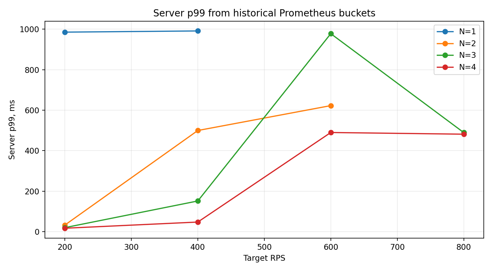

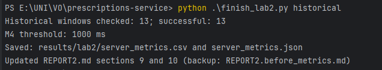

## 10. Додаткова метрика М4 — варіант 6

За методикою поріг визначено за найближчою скінченною межею Г2 до p99 сервера на першій сходинці N=1. Оскільки p99 = 985,557 мс, **T = 1000 мс**. Частка запитів тривалістю не більшою за цей поріг обчислюється як відношення приросту накопичувального бакета `le="1.0"` до приросту загального `_count` за той самий інтервал і маршрут `/prescriptions/{id}`.

Для всіх **13** історичних вікон оцінка M4 після обмеження до фізично допустимого діапазону [0; 1] становить **1,000000 (100%)**. У першому рядку результат скрипта дорівнював **1,000001** через похибку розрахунку приростів; частка не може перевищувати 1, тому в таблиці та графіку обмежена значенням 1. Це стосується лише запитів, завершення яких було враховано серверною гістограмою. Воно не охоплює запити, що залишилися в чергах або завершилися тайм-аутом на стороні клієнта. Тому клієнтське очікування може перевищувати 5 с навіть за M4≈100%. М4 з таким порогом майже не розрізняє ступені навантаження; це обмеження **заданого варіантом правила вибору порогу**, а не причина довільно змінювати T.

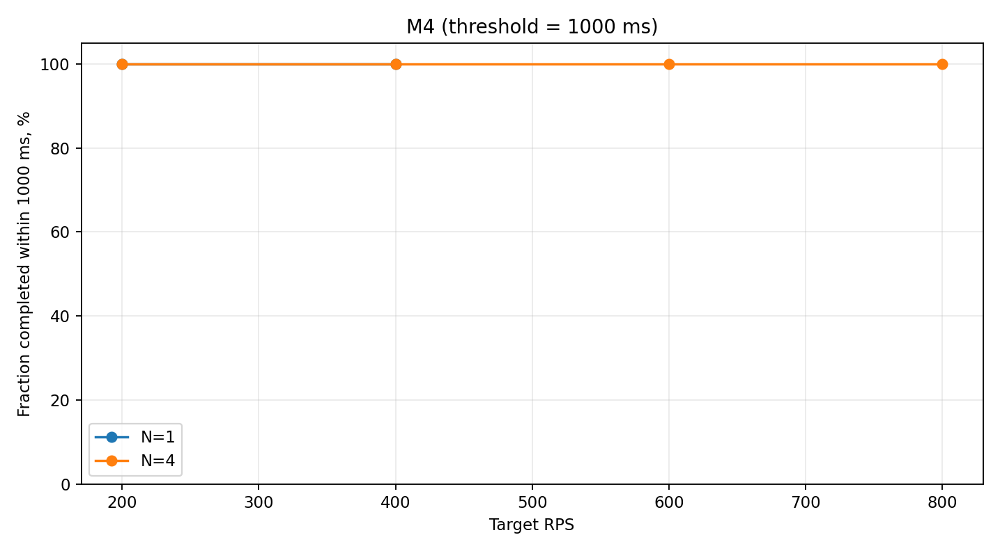

## 11. Синхронне вимірювання ресурсів на N=4

Командою `python finish_lab2.py capture-web4` виконано **окремий повторний прогін** N=4 з одночасним збиранням `docker stats`. Він не підміняє раніше використану чотириточкову серію для USL.

На цьому повторі максимальна досягнута інтенсивність становила **466,867 RPS** на сходинці із заданими **600 RPS**, розкид **49,538 RPS**, клієнтський p99 **4634,653 мс**; перші дві сходинки дали **200,000** і **399,733 RPS**. При цілі 800 RPS було досягнуто лише **386,933 RPS**, із **2864** тайм-аутами. Пік N=4 в попередній серії був **539,667 RPS**; різниця між двома прогонами вказує на мінливість продуктивності та обмежує точність висновків за одиночним повтором.

За останні 15 с пікової сходинки X(4) зібрано **35 вимірювань контейнерних ресурсів** (5 часових зрізів по 7 контейнерів). Показники першого зафіксованого зрізу наведено нижче; інші містяться у `web4_sync_peak_stats.csv`.

| Контейнер | CPU | RAM |
|---|---:|---|
| web-4 | 102.85% | 69.14MiB / 512MiB |
| web-3 | 97.65% | 69.27MiB / 512MiB |
| web-2 | 102.05% | 75.04MiB / 512MiB |
| prometheus-1 | 0.24% | 26.94MiB / 7.446GiB |
| web-1 | 104.25% | 195.5MiB / 512MiB |
| nginx-1 | 18.03% | 7.145MiB / 7.446GiB |
| db-1 | 55.67% | 142.9MiB / 7.446GiB |

Web-контейнери показували близько **100% Docker CPU** на піковій сходинці; показники можуть тимчасово перевищувати 100% через особливості нормалізації/вимірювального інтервалу Docker. Вебконтейнери не досягали 512 MiB пам'яті, натомість спостерігалося насичення процесора й різке зростання p99 клієнта. На цьому зрізі PostgreSQL використовував **55,67% CPU**, а Nginx **18,03% CPU**. Це підтримує висновок, що найімовірніший локальний обмежувач — обчислювальні ресурси web-контейнерів і черга запитів; спільний внесок бази/хоста не можна повністю виключити.

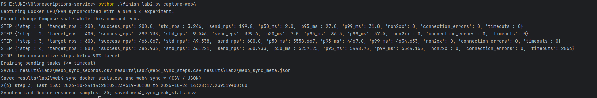

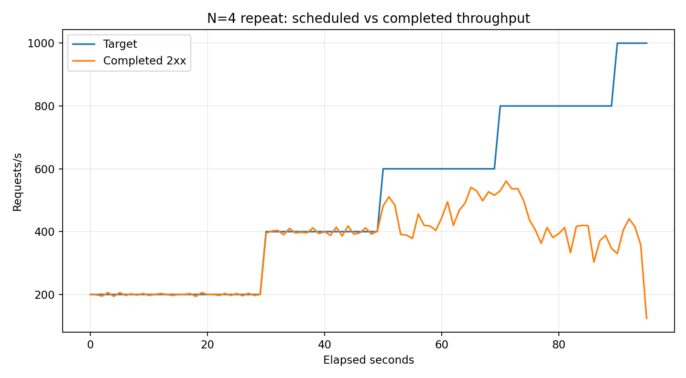

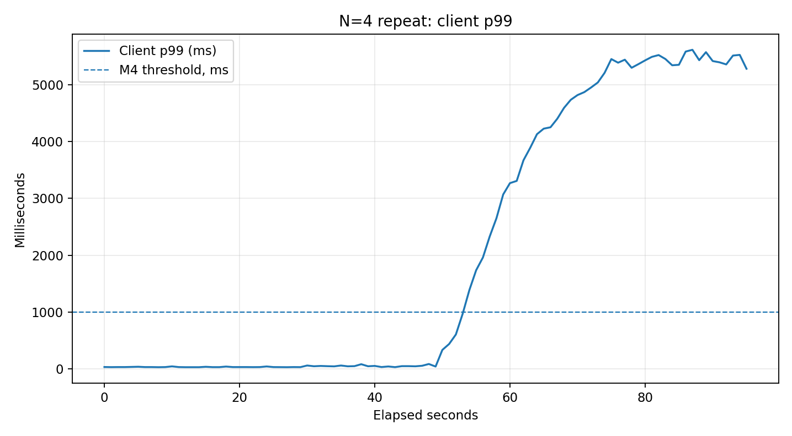

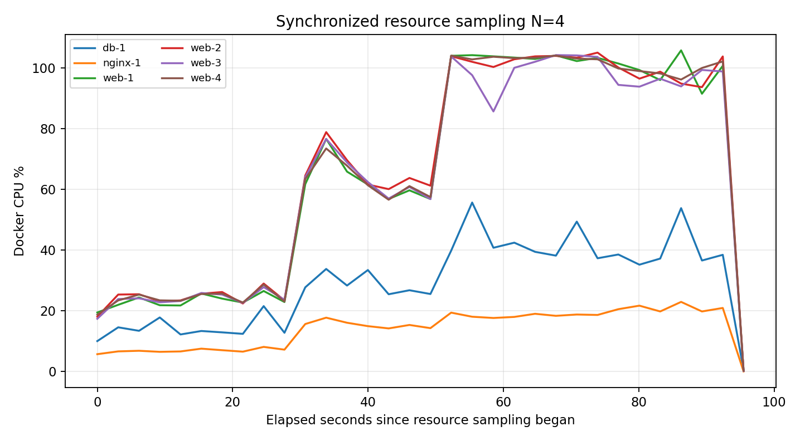

### 11.1. Ресурси процесу генератора навантаження

Під час окремого вимірювання N=4 збережено `generator_resources.csv` із 68 послідовними показниками процесу Python у Windows. Середній CPU становив **24,13% одного логічного процесора**, максимум — **57,81%**. Середнє використання RAM становило **50,17 МБ**, максимум — **67,20 МБ**. Ці статистики описують увесь прогін, а не тільки 15 секунд сходинки X(4), тому їх не слід інтерпретувати як середній CPU генератора саме на піку.

### 11.2. Історична динаміка Prometheus

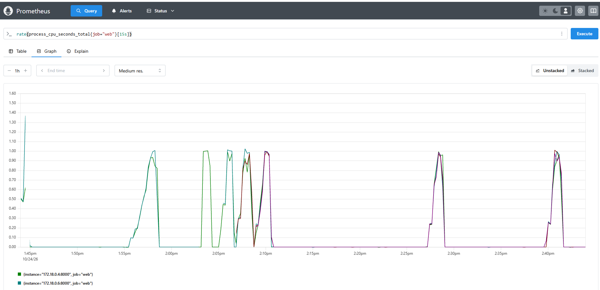

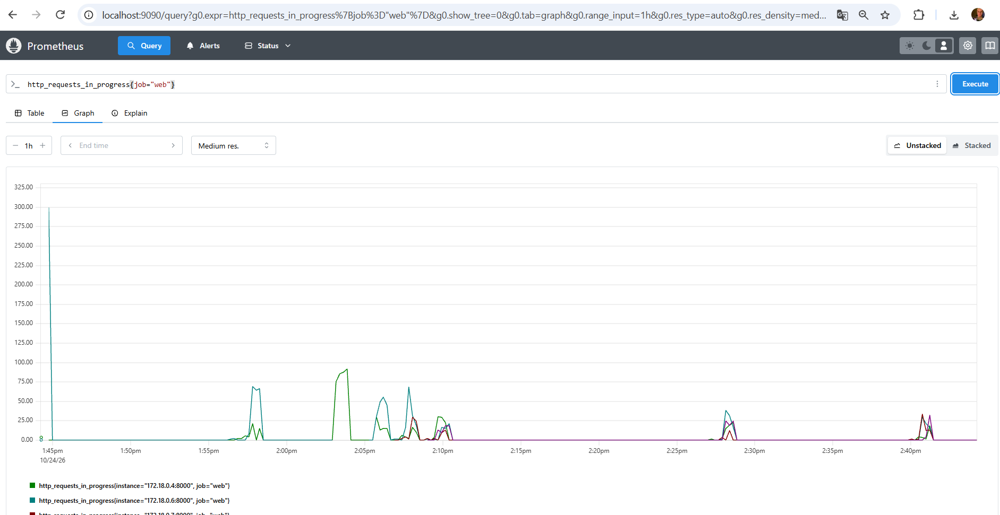

Графіки охоплюють кілька послідовних експериментів. Вони підтверджують зміну навантаження та станів процесу, але без розмітки інтервалів N=1 і N=4 не можуть використовуватися як числове джерело для середніх значень на окремих сходинках. Серверний p99 для кожної сходинки наведено в розділі 9, а посекундний p99 клієнта — в CSV генератора.

## 12. Висновки

Сервіс лабораторної №1 доповнено метриками Prometheus і перевірено для 1–4 екземплярів Docker Compose. Цілі моніторингу переходили у стан `4/4 UP`, а заголовок `X-Pod` підтвердив маршрутизацію між чотирма web-контейнерами. Після виправлення Nginx тест SIGTERM завершився `ExitCode=0` без помилок у контрольному вікні.

В основній серії виміряно X(1)=171,133, X(2)=328,200, X(3)=424,933, X(4)=539,667 RPS, що відповідає C(4)=3,1535. Оцінка USL для цієї серії: σ≈0,064106, κ≈0,007341, модельне N*≈11,29; останнє є екстраполяцією поза досліджуваними N. Нестабільний результат N=1 і різниця між повторними вимірюваннями N=4 обмежують надійність кількісного прогнозу.

Серверний p99 відновлено за історичними лічильниками гістограми у всіх 13 вікнах; на першій сходинці N=1 він становить 985,557 мс із максимальною бакетною похибкою 500 мс. За правилом М4 обрано T=1000 мс. За цим досить високим порогом гістограма дала частку ≈100% на всіх сходинках N=1 і N=4, хоча клієнтські затримки на перевантаженні були значно вищими. Таким чином М4 відображає серверну тривалість, але не всю затримку клієнта.

Синхронний прогін N=4 показав X(4)=466,867 RPS за іншого запуску, а під час пікової сходинки CPU усіх web-контейнерів перебував близько 100%. Вичерпання пам'яті не виявлено. Найбільш правдоподібними обмежувачами за цими вимірюваннями є CPU web та зростання черг. Ресурси генератора та історичні графіки Prometheus додано; обмеженням залишаються відсутні числові середні CPU/in-progress для кожної пікової сходинки основної серії та відсутність єдиної часової панелі p99 для N=1 і N=4.

## 13. Використання генеративних моделей і перевірка

Генеративну модель використано для створення доповнень до FastAPI, конфігурації Prometheus та Docker Compose, генератора навантаження, аналізу логів, формування графіків. Розгортання контейнерів, HTTP-відповіді, Prometheus Targets, X-Pod і SIGTERM перевірено практичними тестами; навантажувальні прогони виконано локально. Числові вимірювання, яких немає у наданих матеріалах, не реконструйовано як фактичні результати.

## 14. Дані і відтворюваність

Первинні CSV/JSON-файли та журнали експериментів збережено в `results/lab2/`, а докази у вигляді скриншотів і графіків — у `images/lab2/`. Основну серію представлено файлами `web1_final_*`–`web4_final_*`; окремо збережено `web1_refined_*`, `web4_sync_*`, `noop_extended_*`, `shutdown_fixed.csv`, `server_metrics.csv`, `server_metrics.json` і `generator_resources.csv`. Для перевірки результатів використовуються саме ці первинні файли, а не повторна ручна транскрипція.
