# Лабораторна робота № 3. Сервіс у Kubernetes з автомасштабуванням і без нього

**Дисципліна:** Високопродуктивні розподілені обчислювальні системи  
**Варіант:** 6  
**Основа:** CRUD-сервіс призначень препаратів `/prescriptions`, розроблений у лабораторній роботі № 1 та інструментований у лабораторній роботі № 2.  
**Дата експериментів:** 26.10.2026.

## 1. Мета і постановка завдання

Перенести наявний FastAPI-сервіс, PostgreSQL і моніторинг у локальний кластер Kubernetes, перевірити працездатність CRUD та персистентність даних, дослідити масштабованість при фіксованій кількості pod-ів і порівняти фіксовані три репліки з HorizontalPodAutoscaler під однаковим змінним навантаженням.

Для варіанта 6 максимальна кількість реплік становить **R=3**. Додаткова вимога Д2 полягає у відтворенні дефіциту підключень PostgreSQL при `max_connections=2·15+5=35`, визначенні першого N з помилками та перевірці виправлення `DB_POOL_SIZE=floor((35−4)/3)=10`.

## 2. Стенд та реалізація

Експерименти виконано локально у Docker Desktop 4.95.0 / Docker Engine 29.8.2. Кластер створено за допомогою **kind v0.33.0** з Kubernetes **v1.37.0** і containerd 2.3.4. Клієнт `kubectl` має версію v1.36.1. Повний машинозчитуваний опис середовища збережено у `results/lab3/environment.json`.

Топологія кластера: один control-plane і два worker. На control-plane встановлено мітку `role=infra`; PostgreSQL, Prometheus, kube-state-metrics, postgres-exporter і metrics-server закріплено за цим вузлом. Web-pod-и плануються на worker-вузлах. Порти NodePort 30080 і 30090 відображено на `localhost:8080` і `localhost:9090`.

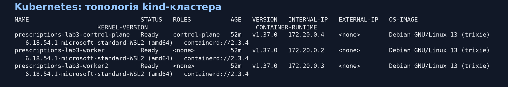

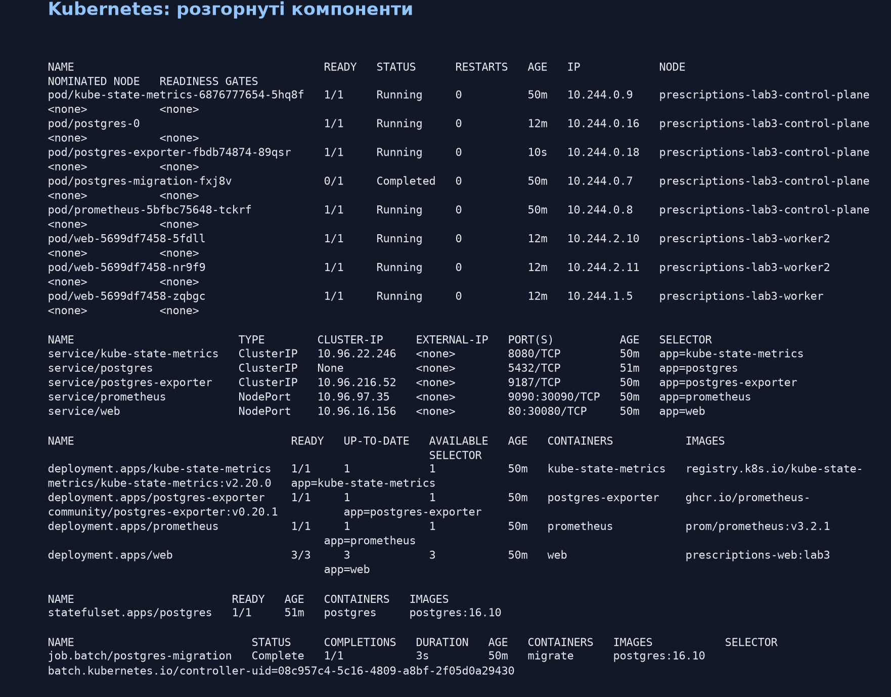

Основні компоненти реалізації:

| Компонент | Реалізація |
|---|---|
| PostgreSQL | StatefulSet, headless Service, PVC 1 GiB, `postgres:16.10`, базове `max_connections=100` |
| Міграція | окремий одноразовий Job зі схемою `db/init.sql` |
| Web | Deployment без поля `replicas`, NodePort Service, образ `prescriptions-web:lab3` |
| Ресурси web | request CPU 250m, limit CPU 500m, request RAM 128 MiB, limit RAM 512 MiB |
| Перевірки web | readiness `/healthz`, liveness `/livez`, `preStop.sleep=5s`, grace period 15 с |
| Пул БД | `DB_POOL_SIZE=15`, `max_overflow=0`; для виправлення Д2 — 10 |
| HPA | CPU 70%, min 1, max 3, scale-down stabilization 30 с |
| Prometheus | `prom/prometheus:v3.2.1`, scrape 5 с, Kubernetes pod discovery |
| Інші метрики | cAdvisor через API server proxy, kube-state-metrics v2.20.0, postgres-exporter v0.20.1, metrics-server v0.9.0 |

Secret створюється з локального `.env`, тому пароль БД відсутній у маніфестах і звіті. Prometheus RBAC не дозволяє читати Secrets. Для локального kind у metrics-server використано `--kubelet-insecure-tls`, оскільки kubelet має самопідписаний сертифікат; перевірку TLS Kubernetes API не вимкнено.

## 3. Функціональна перевірка і персистентність

Скрипт `lab3/verify.ps1` виконав повний цикл CRUD. Отримано HTTP 201 для POST, 200 для GET і PUT та 204 для DELETE. Заголовок `X-Pod` був присутній у відповідях і містив фактичне ім'я web-pod-а. Під час фінальної перевірки різні операції обслуговували pod-и `web-5699df7458-5fdll` і `web-5699df7458-nr9f9`, що також підтверджує маршрутизацію між репліками.

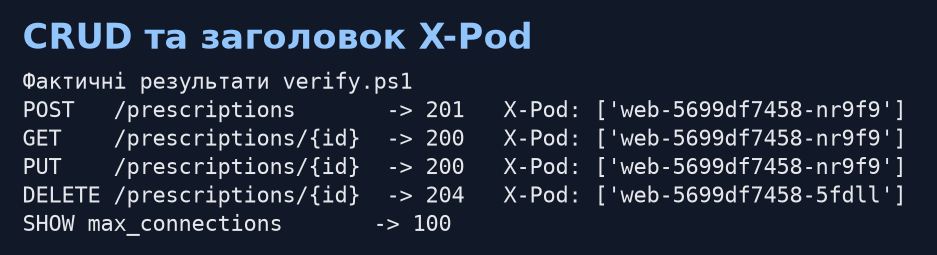

Персистентність перевірено окремим прогоном: запис створено й оновлено, pod `postgres-0` видалено, після автоматичного відтворення StatefulSet запис знову успішно прочитано з HTTP 200, а потім видалено. Отже, дані збереглися у PVC, а не в ефемерній файловій системі pod-а.

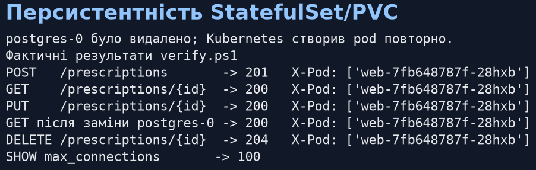

Для основних тестів скрипт `seed.py` створив і перевірив 100 записів з ID 3–102. Повторний запуск seed не очищав раніше створені дані.

## 4. Моніторинг

Перед навантаженням перевірено всі обов'язкові scrape jobs. У фінальному стані Prometheus мав **3/3 web**, **3/3 cAdvisor**, **1/1 kube-state-metrics** і **1/1 postgres-exporter** у стані UP, без `lastError`.

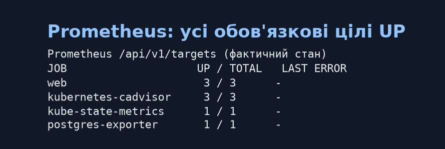

Перевірено наявність рядів:

- `http_requests_total` і гістограми тривалості для кожного web-pod-а;
- `container_cpu_cfs_periods_total` та `container_cpu_cfs_throttled_periods_total` для web;
- `kube_deployment_status_replicas_ready` і метрики HPA;
- `pg_up` та `pg_stat_activity_count`;
- Metrics API для команд `kubectl top nodes/pods`.

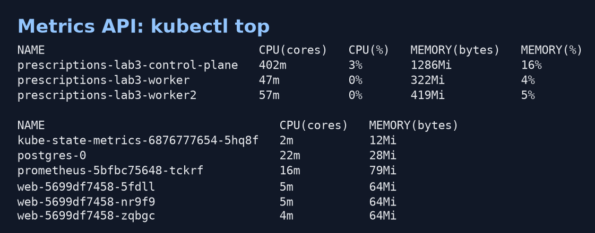

Prometheus опитував цілі кожні 5 с. Колектор зберіг не тільки CSV часових рядів, а й JSON зі статусом кожного PromQL-запиту. Відсутні ряди не підмінялися нулями: скрипт завершувався помилкою, якщо обов'язкова метрика не була отримана.

## 5. Методика навантаження

Генератор `k8s_load_test.py` працює у відкритому контурі: час надходження кожного запиту задається наперед і не залежить від завершення попереднього. Постійно підтримуються **24 HTTP/1.1 keep-alive з'єднання** (`8·R`), кожне перевідкривається після 100 запитів. Після перевідкриття виконується `/livez`, щоб нове з'єднання було встановлене до участі в основному потоці.

Для фіксованої серії використано 10 с прогріву при 200 RPS, далі сходинки 200, 400, 600, ... RPS по 30 с. У підсумок сходинки входять останні 20 с. Прогін припиняється після двох послідовних сходинок з досягненням менше 90% цілі. `X(N)` — максимальний середній успішний 2xx RPS у підсумковому вікні; SD — стандартне відхилення посекундного успішного RPS у тому самому вікні.

Клієнтська затримка відраховується від **запланованого** часу надходження, тому включає очікування у внутрішній черзі генератора. Через це p99 на перевантажених сходинках може перевищувати HTTP timeout 5 с. Окремо записані `queue_rejected`, `cancelled`, HTTP non-2xx, connection errors і timeouts; вони не змішуються в один штучний показник.

Для N=1 і N=2 виконано по одному прогону, для N=3 — три незалежні прогони з паузами 30 с. Загалом у базовій серії збережено п'ять наборів `seconds/steps/requests/pods/errors/meta/prometheus`.

## 6. Фіксована кількість реплік

### 6.1. Результати всіх виміряних сходинок

У таблиці не наведено прогрів; усі інші рядки є фактичними 20-секундними підсумковими вікнами.

| N | Повтор | Ціль, RPS | Досягнуто 2xx, RPS | Досягнення, % | p99 клієнта, мс | Queue rejected | Не-2xx |
|---:|---:|---:|---:|---:|---:|---:|---:|
| 1 | 1 | 200 | 76,600 | 38,30 | 24482,690 | 1944 | 0 |
| 1 | 1 | 400 | 75,200 | 18,80 | 39667,000 | 6490 | 0 |
| 2 | 1 | 200 | 144,400 | 72,20 | 10655,000 | 0 | 0 |
| 2 | 1 | 400 | 150,300 | 37,58 | 20042,500 | 4994 | 0 |
| 3 | 1 | 200 | 171,350 | 85,68 | 2897,960 | 0 | 0 |
| 3 | 1 | 400 | 197,600 | 49,40 | 15895,990 | 3554 | 0 |
| 3 | 2 | 200 | 199,300 | 99,65 | 266,150 | 0 | 0 |
| 3 | 2 | 400 | 207,750 | 51,94 | 14222,000 | 2717 | 0 |
| 3 | 2 | 600 | 216,600 | 36,10 | 15102,793 | 7668 | 0 |
| 3 | 3 | 200 | 201,450 | 100,73 | 332,160 | 0 | 0 |
| 3 | 3 | 400 | 218,450 | 54,61 | 13516,820 | 2439 | 0 |
| 3 | 3 | 600 | 214,450 | 35,74 | 15808,160 | 7709 | 0 |

У кожному прогоні дві останні сходинки були нижчими за 90% цілі, тому межу насичення знайдено і всі X(N) придатні для оцінювання USL. HTTP non-2xx, connection errors і timeouts у базовій серії дорівнювали нулю. Водночас `peak_pending=3000` і відхилення завдань чергою на перевантаженні показують, що верхні сходинки обмежені також можливостями клієнтського планувальника; це враховано у розділі обмежень.

### 6.2. Пропускна здатність і розкид

| N | Повтори | X(N), RPS | SD, RPS | Ціль пікової сходинки | p99 клієнта, мс | Середній server p99, мс | Середній throttle | Макс. throttle |
|---:|---:|---:|---:|---:|---:|---:|---:|---:|
| 1 | 1 | **76,600** | 4,176 | 200 | 24482,690 | 496,058 | 1,000 | 1,000 |
| 2 | 1 | **150,300** | 6,427 | 400 | 20042,500 | 334,286 | 1,000 | 1,000 |
| 3 | 1 | 197,600 | 38,424 | 400 | 15895,990 | 336,653 | 0,838 | 1,000 |
| 3 | 2 | 216,600 | 14,702 | 600 | 15102,793 | 206,226 | 0,940 | 1,000 |
| 3 | 3 | 218,450 | 26,312 | 400 | 13516,820 | 272,899 | 1,000 | 1,000 |
| 3, середнє | 3 | **210,883** | **9,423 між повторами** | — | — | — | — | — | — |

Значення throttling — частка CFS-періодів, у яких контейнер було обмежено, а не частка втраченого процесорного часу. Значення поблизу 1 разом із CPU limit 500m підтверджують постійне процесорне обмеження web на пікових сходинках. Клієнтський p99 значно більший за server p99, оскільки перший включає чергу до початку HTTP-запиту.

### 6.3. Розподіл за pod-ами

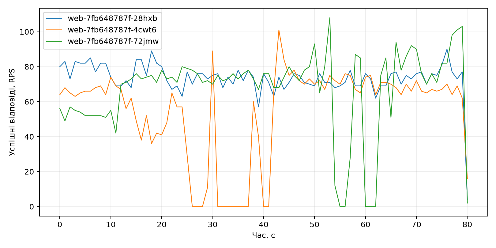

Коефіцієнт дисбалансу `I=Xmax/Xavg` обчислено за тим самим вікном, що й X(N):

| Прогін | I | Busy RPS | Busy server p99, мс | Busy throttle | Least RPS | Least server p99, мс | Least throttle |
|---|---:|---:|---:|---:|---:|---:|---:|
| N=2, повтор 1 | 1,028 | 77,250 | 199,441 | 1,000 | 73,050 | 469,131 | 1,000 |
| N=3, повтор 1 | 1,086 | 71,550 | 465,207 | 1,000 | 55,950 | 69,833 | 0,514 |
| N=3, повтор 2 | 1,038 | 74,950 | 222,000 | 0,821 | 69,000 | 198,127 | 1,000 |
| N=3, повтор 3 | 1,033 | 75,200 | 197,380 | 1,000 | 70,750 | 425,907 | 1,000 |

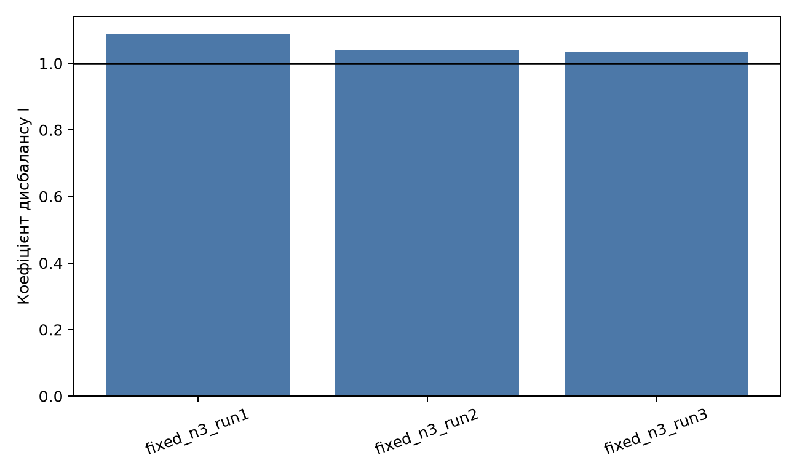

Розподіл загалом близький до рівномірного, але перший повтор N=3 мав найбільший дисбаланс 1,086. Ротація keep-alive з'єднань кожні 100 запитів дала новим pod-ам можливість отримувати трафік; без ротації довгоживучі з'єднання могли б довше залишатися прив'язаними до старих endpoint-ів.

## 7. Універсальний закон масштабованості і порівняння з Compose

Використано модель:

\[
X_{model}(N)=\frac{\lambda N}{1+\sigma(N-1)+\kappa N(N-1)}, \qquad \lambda=X(1)=76{,}600.
\]

Лінеаризація `y=N/C(N)−1`, де `C(N)=X(N)/X(1)`, дала:

| N | X(N), RPS | C(N) | y(N) |
|---:|---:|---:|---:|
| 1 | 76,600 | 1,000000 | 0 |
| 2 | 150,300 | 1,962141 | 0,019295 |
| 3 | 210,883 | 2,753046 | 0,089702 |

Незалежна найменших квадратів оцінка дала від'ємну σ, тому відповідно до фізичного обмеження параметр перенесено на межу `σ=0` і повторно оцінено κ. Результат:

\[
\sigma=0, \qquad \kappa\approx0{,}014420, \qquad
N^*=\sqrt{\frac{1-\sigma}{\kappa}}\approx8{,}33.
\]

`N*` є лише екстраполяцією моделі за трьома точками N=1–3, а не експериментально перевіреним оптимумом.

Для лабораторної № 2 у Docker Compose було отримано X(1)=171,133, X(2)=328,200, X(3)=424,933 і X(4)=539,667 RPS, `σ≈0,064106`, `κ≈0,007341`, `N*≈11,29`. Абсолютна продуктивність Compose для N=1–3 вища приблизно у 2,23; 2,18 і 2,02 раза. Пряме трактування цієї різниці як «накладних витрат Kubernetes» некоректне: у Compose web мав limit **1 CPU**, а в Kubernetes — **0,5 CPU**. Відносна масштабованість до N=3 у Kubernetes, навпаки, вища: C(3)=2,753 проти 2,483 у Compose.

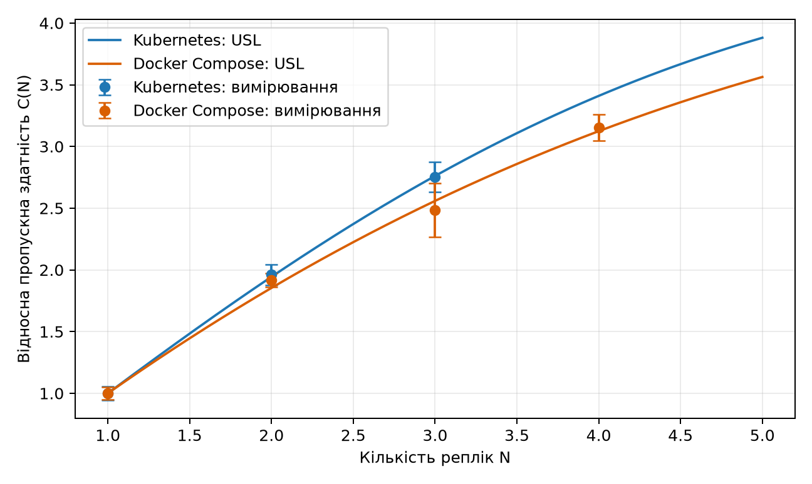

## 8. Фіксований профіль і HPA

За виміряними значеннями `X(1)=76,600` та `X(3)=210,883` сформовано профіль:

- 30 с при `0,3·X(1)=22,980 RPS`;
- 60 с при `min(2·X(1),0,9·X(3))=153,200 RPS`;
- 90 с при 22,980 RPS.

### 8.1. Результати трьох ділянок

| Режим | Ділянка | Ціль, RPS | Успішно, RPS | p99 клієнта, мс | Queue rejected | Не-2xx |
|---|---|---:|---:|---:|---:|---:|
| fixed-3 | low before | 22,980 | 22,967 | 30,476 | 0 | 0 |
| fixed-3 | spike | 153,200 | 149,200 | 1437,164 | 0 | 0 |
| fixed-3 | low after | 22,980 | 25,644 | 1886,219 | 0 | 0 |
| HPA | low before | 22,980 | 22,967 | 35,992 | 0 | 0 |
| HPA | spike | 153,200 | 58,333 | 36836,834 | 2692 | 0 |
| HPA | low after | 22,980 | 56,300 | 42781,118 | 1 | 0 |

Фіксовані три репліки обслужили всі **11949/11949** запланованих запитів. HPA-прогін обслужив **9256/11949**, а 2693 завдання було відхилено внутрішньою чергою генератора. Високий RPS і p99 на ділянці `low after` у HPA-прогоні означають дренування черги, накопиченої під час spike, а не перевищення нової низької цілі.

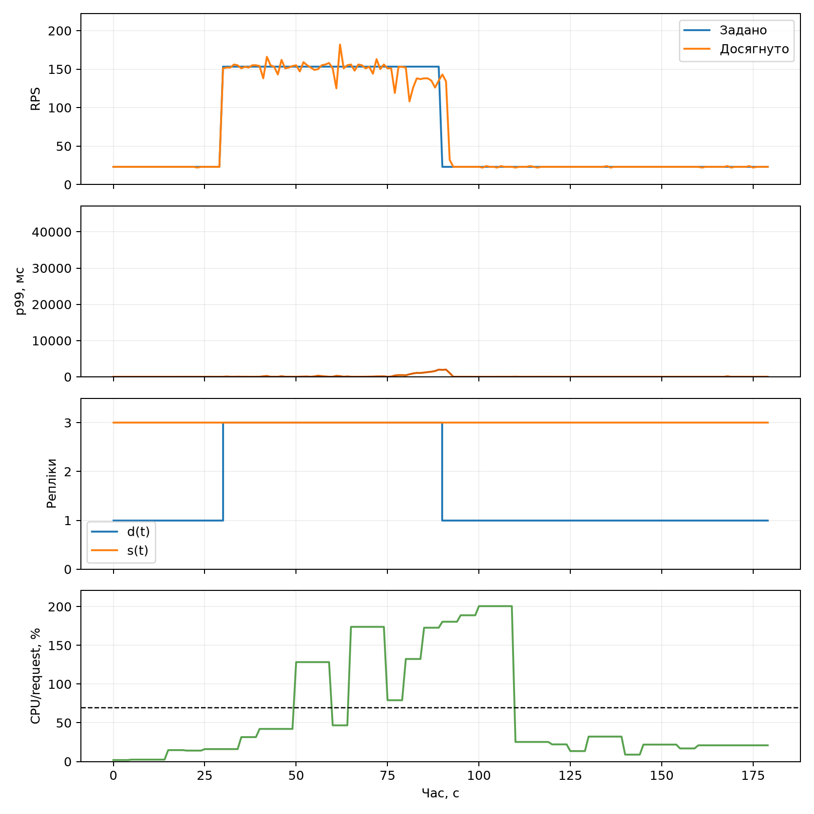

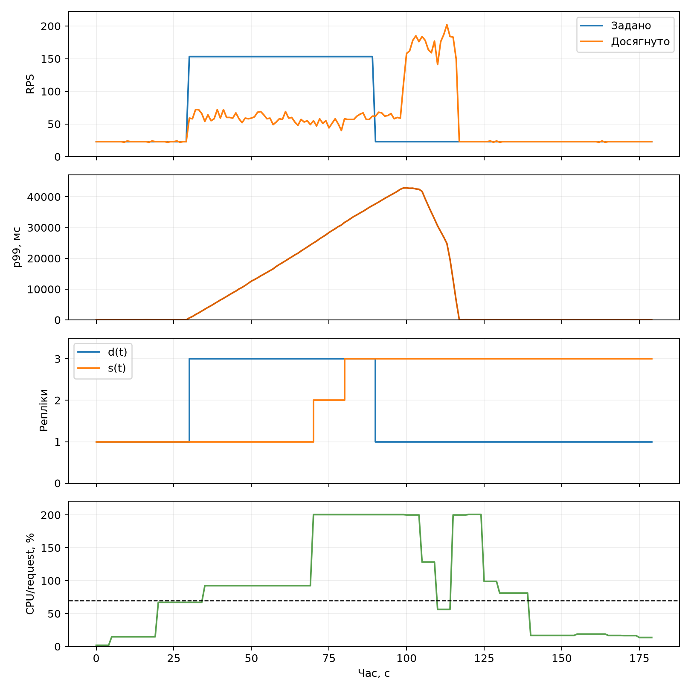

### 8.2. Метрики еластичності

Потрібна кількість реплік `d(t)` визначена як мінімальне N, для якого виміряне X(N) не менше за цільову інтенсивність. Для цього профілю `d(t)=1,3,1`. Фактична кількість готових реплік — `s(t)`.

| Режим | θU | θO | aU | aO | W, replica·s | Секунд p99 > 2·p99₀ | Не-2xx |
|---|---:|---:|---:|---:|---:|---:|---:|
| fixed-3 | 0,0000 | 0,6667 | 0,0000 | 1,3333 | 540 | 37 | 0 |
| HPA | 0,2778 | 0,5000 | 0,5000 | 1,0000 | 390 | 87 | 0 |

Фіксований режим не мав дефіциту реплік, але дві третини часу був надлишково виділеним. HPA зменшив витрати з 540 до 390 replica·s (**−27,8%**), проте 27,78% часу мав замало готових реплік і 87 секунд порушував поріг p99 проти 37 секунд у fixed-3.

За часовими рядами Prometheus:

- бажана кількість HPA вперше стала більшою за 1 через **30 с** після початку spike;
- максимум **3 ready replicas** досягнуто через **50 с** після початку spike;
- протягом spike p99 не утримувався 10 с поспіль нижче `1,2·1437,164=1724,597 мс`, тому час відновлення p99 не визначено;
- перше зменшення ready відбулося через **90 с після завершення spike**; до однієї репліки HPA перейшов уже після основного 180-секундного вікна.

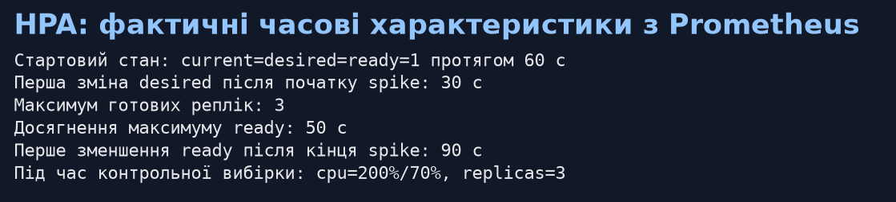

Під час контрольної вибірки HPA показував `cpu: 200%/70%` і три репліки. 200% від request 250m відповідає фактичному CPU близько 500m, тобто встановленому limit. Масштабування запізнилося відносно 60-секундного spike; довгоживучі keep-alive з'єднання та накопичена черга додатково затримали перерозподіл роботи на нові pod-и.

## 9. Додаткова вимога Д2 — дефіцит підключень PostgreSQL

### 9.1. Відтворення

Після базових тестів встановлено `max_connections=35` і залишено `DB_POOL_SIZE=15`. Виконано однаковий ступінчастий профіль послідовно для N=1,2,3.

| Конфігурація | N | Xpeak, RPS | p99 клієнта, мс | HTTP 500 | Connection errors | Timeouts | pg_stat_activity після прогону |
|---|---:|---:|---:|---:|---:|---:|---|
| pool 15, max 35 | 1 | 62,400 | 49914,120 | 0 | 0 | 0 | active 1, idle 16 |
| pool 15, max 35 | 2 | 101,950 | 30326,240 | 0 | 0 | 0 | active 1, idle 31 |
| pool 15, max 35 | 3 | 161,450 | 18587,550 | **20** | 0 | 0 | контрольний psql також відхилено через вичерпання ліміту |

Перші помилки з'явилися при **N=3**. У `d2_starved_n3_requests.csv` міститься 12286 відповідей HTTP 200 і 20 відповідей HTTP 500. Журнали web містять `sqlalchemy.exc.OperationalError`, а PostgreSQL — повторювані `FATAL: sorry, too many clients already`. Отже, причина підтверджена одночасно з боку клієнта, застосунку і БД.

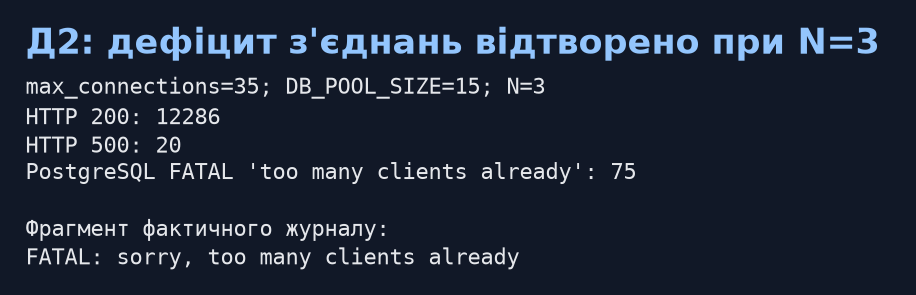

### 9.2. Виправлення

Безпечний пул:

\[
DB\_POOL\_SIZE=\left\lfloor\frac{35-4}{3}\right\rfloor=10.
\]

Після встановлення pool=10 той самий N=3 і той самий профіль дали 11233 HTTP 200, **0 HTTP 500**, 0 connection errors і 0 timeouts. У `pg_stat_activity` після прогону було 29 idle та 1 active прикладне підключення; чотири підключення залишено як резерв для службових операцій. Після завершення Д2 відновлено базові `max_connections=100` і `DB_POOL_SIZE=15`, а smoke-тест знову пройдено.

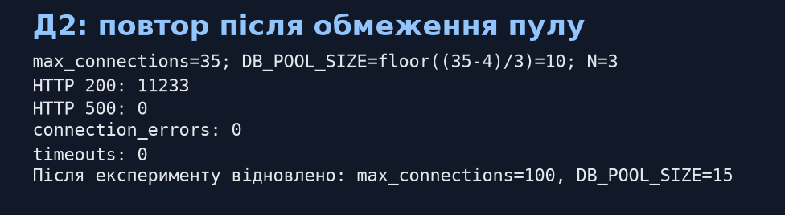

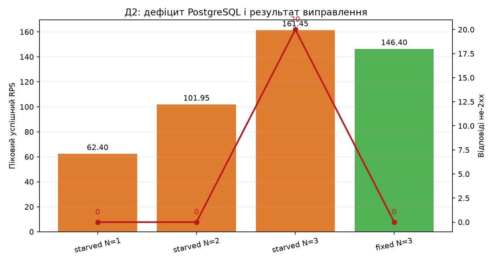

Після виправлення піковий RPS (146,400) нижчий за одиночний starved-прогін N=3 (161,450), а клієнтський p99 зменшився з 18587,550 до 10275,730 мс. Єдиний повтор не дозволяє приписувати різницю пропускної здатності лише пулу. Надійний висновок Д2 — усунення 20 HTTP 500 і помилок `too many clients`; твердження про гарантоване зростання throughput не робиться.

## 10. Обмеження експерименту

1. Для N=1 і N=2 виконано по одному базовому прогону; міжпрогоновий SD доступний лише для N=3. Тому невизначеність X(1) та X(2) не оцінено.
2. На перевантаженні внутрішня черга генератора досягала ліміту 3000. X(N) відображає фактично завершені 2xx, але p99 включає очікування від запланованого arrival time і не є чистим мережевим або серверним часом.
3. USL побудовано лише за N=1–3. Значення N*=8,33 виходить за межі вимірювань і є модельною екстраполяцією.
4. Порівняння абсолютного RPS з лабораторною № 2 не є ізоляцією накладних витрат Kubernetes, бо ліміти CPU відрізняються: 0,5 CPU проти 1 CPU.
5. Профілі fixed/HPA та Д2 після виправлення виконано по одному разу; для статистично стійкого порівняння потрібні додаткові повтори.
6. HPA реагує на усереднену CPU-метрику з дискретністю Metrics API/контролера, а Prometheus має scrape 5 с. Часові оцінки мають відповідну дискретність.

## 11. Контроль виконання вимог

| Вимога | Фактичний результат |
|---|---|
| kind: 1 control-plane + 2 worker | виконано, усі вузли Ready |
| StatefulSet + PVC + headless Service | виконано; persistence test пройдено |
| Secret із `.env`, міграція Job | виконано; пароль не записано в Git |
| Web resources і probes | 250m/500m, 512 MiB, `/healthz`, `/livez` |
| preStop 5 с, grace 15 с | виконано |
| Prometheus 5 с і pod discovery | виконано |
| cAdvisor, kube-state-metrics, postgres-exporter | усі цілі UP |
| metrics-server та `kubectl top` | виконано |
| 24 keep-alive, ротація після 100 | виконано й записано у meta JSON |
| N=1,2 та три повтори N=3 | виконано |
| Розподіл X-Pod і дисбаланс | обчислено для повних наборів pod-ів |
| USL і порівняння з Compose | виконано з поясненням різних CPU limits |
| fixed-3 проти HPA | два однакові 180-секундні профілі виконано |
| θU, θO, aU, aO, W, p99 violations | обчислено |
| HPA timings | desired 30 с, max ready 50 с, перший scale-down 90 с після spike |
| Д2: перший N з помилками | N=3, 20 HTTP 500 |
| Д2: pool=10 | повтор N=3 без помилок; базові значення відновлено |

## 12. Використання генеративних моделей і перевірка

Генеративну модель використано для підготовки Kubernetes-маніфестів, PowerShell runbook, генератора навантаження, колектора Prometheus, аналізатора та оформлення звіту. Кожен числовий висновок перевірено практичним запуском і походить з локальних CSV/JSON, логів Kubernetes/PostgreSQL або часових рядів Prometheus. Доказові зображення 1–6, 12–14 є візуалізацією фактичних команд і збережених результатів, а графіки 7–11 і 15 побудовано безпосередньо з CSV.

## 13. Дані і відтворюваність

У `results/lab3/` збережено **111 файлів**: опис середовища, smoke/persistence JSON, 100 ID, сирі посекундні та позапитні дані, таблиці сходинок, розподіл за pod-ами, помилки, metadata, Prometheus CSV/JSON, журнали Д2, `pg_stat_activity` та підсумкові таблиці аналізу. У `images/lab3/` збережено **15 PNG**.

Основні команди відтворення:

```powershell
.\lab3\deploy.ps1
.\lab3\verify.ps1
.\lab3\verify.ps1 -Persistence
python .\seed.py --base-url http://localhost:8080 --count 100 --output .\results\lab3\ids.json
.\lab3\run-fixed-series.ps1
python .\analyze_lab3.py
.\lab3\run-elasticity.ps1
.\lab3\run-d2.ps1 -Phase Starved
.\lab3\run-d2.ps1 -Phase Fixed
.\lab3\d2.ps1 -Mode Restore
python .\analyze_lab3.py
python .\create_lab3_evidence.py
```

## 14. Висновки

Повний Kubernetes-стенд розгорнуто та перевірено. CRUD, `X-Pod`, моніторинг, Metrics API і персистентність PostgreSQL працюють. Базова фіксована серія дала X(1)=76,600, X(2)=150,300 і середнє X(3)=210,883 RPS; три повтори N=3 мають міжпрогоновий SD 9,423 RPS. Розподіл між pod-ами був близьким до рівномірного, I=1,033–1,086 для N=3.

Оцінка USL для Kubernetes: σ=0, κ≈0,014420, модельне N*≈8,33. Абсолютний RPS нижчий за Compose, але Kubernetes мав удвічі менший CPU limit на web; відносне C(3)=2,753 перевищило Compose C(3)=2,483.

Фіксовані три репліки краще витримали короткий spike: 149,2 RPS і p99 1,437 с проти 58,333 RPS та p99 36,837 с у HPA. HPA заощадив 27,8% replica·s, але досяг трьох ready pod-ів лише через 50 с, тобто майже наприкінці 60-секундного spike, і не відновив p99 у межах spike. Для такого короткого профілю економія ресурсів отримана ціною значно гіршої затримки.

Д2 підтвердила дефіцит PostgreSQL при N=3, pool=15 і max_connections=35: 20 HTTP 500 та `FATAL: too many clients already`. Розрахований pool=10 усунув помилки при повторному N=3. Після експерименту базову конфігурацію 100/15 відновлено й повторно перевірено.
