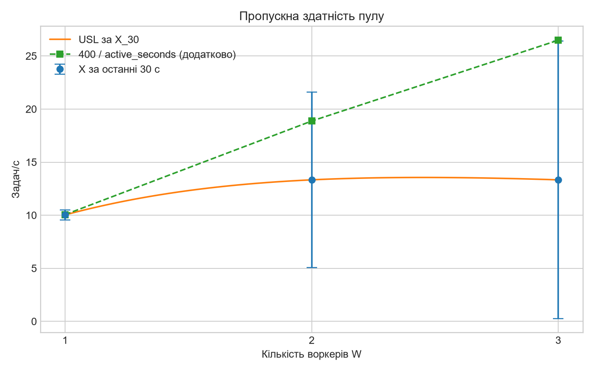
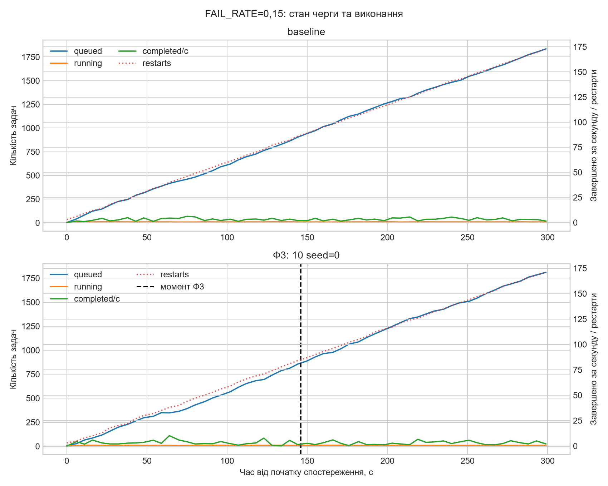
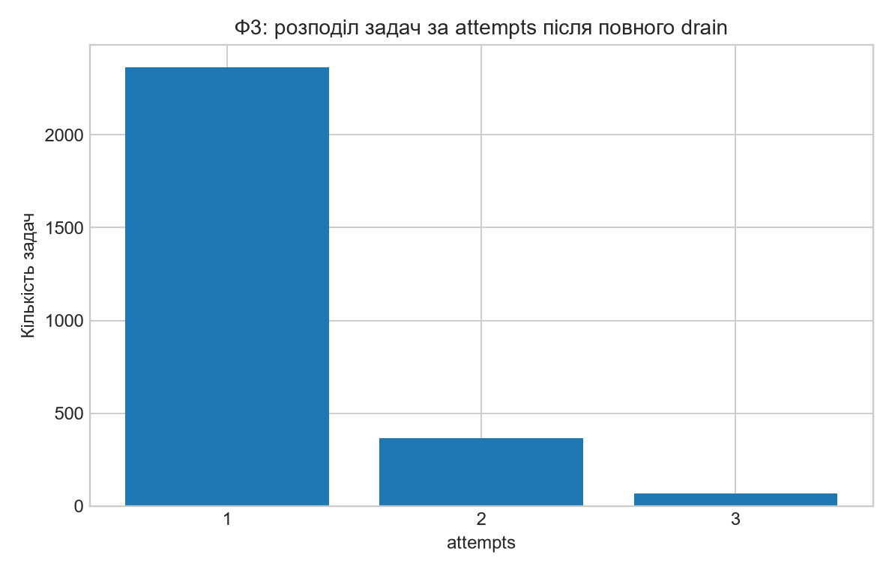
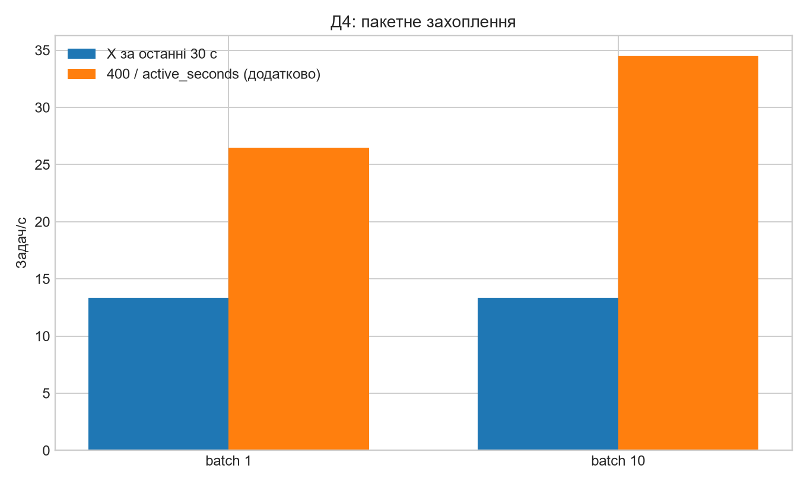

# Лабораторна робота № 4. Синхронізація пулу воркерів

**Дисципліна:** Високопродуктивні розподілені обчислювальні системи 
**Варіант:** 6  
**Основа:** Kubernetes-стенд лабораторної роботи № 3  
**Дата експериментів:** 8 листопада 2026 року

## 1. Мета і параметри варіанта

Мета роботи — реалізувати чергу задач у PostgreSQL і пул окремих воркерів,
експериментально показати race condition наївного захоплення, усунути дублі
рядковим блокуванням, перевірити lease, heartbeat, fencing token,
ідемпотентність результату, масштабування, закон Літтла та зупинку за SIGTERM.

Для варіанта 6 використано `q_lo=0,01`, `q_hi=0,99`, `T_poll=100 мс`,
`L=15 с`, `R=3`, сценарій Ф3 і додаткову вимогу Д4. Зріз має розмір
`256×256`; worker працює без NumPy/Numba.

## 2. Реалізація

Міграція `lab4/migration.sql` додає `tasks` та `task_results`. У `tasks`
зберігаються стан, `record_id`, `seed`, `attempts`, `max_attempts=3`, `token`,
`lease_until`, worker і часові позначки; індекс створено за
`(status, created_at)`. `task_results.task_id` є первинним ключем.

Web API доповнено маршрутами:

- `POST /prescriptions/{id}/tasks` — HTTP 202 або 404;
- `GET /tasks/{id}` — стан і результат;
- `GET /tasks` — фільтр за статусом, `limit` і `offset`;
- `/metrics` — `tasks_queued` і `tasks_running`, оновлення кожні 5 с.

Worker має окремий образ і Deployment. Він отримує `WORKER_ID` через Downward
API, послідовно виконує HTTP fetch, гістограмну обробку та транзакційний store.
Метрики: `worker_tasks_total`, `worker_claims_total`,
`worker_task_duration_seconds` і `worker_tasks_in_flight`.

У штатному режимі захоплення виконується однією командою з
`FOR UPDATE SKIP LOCKED`. Під час claim збільшуються `attempts` і `token`,
lease продовжується кожні 5 с. Прострочені задачі повертаються в `queued`, а на
третій невдалій спробі — у `failed`. Завершення з умовою за token і
`INSERT ... ON CONFLICT DO NOTHING` виконуються однією транзакцією.

## 3. Калібрування одного воркера

Наскрізний smoke-тест завершив задачу й повернув детермінований JSON-результат.
Для серії з 20 задач середні тривалості за Prometheus становили:

| Крок | Середній час, с |
|---|---:|
| claim | 0,002041 |
| fetch | 0,008495 |
| process | 0,066495 |
| store | 0,010873 |

Отже, `t_io=0,019368 с`, `t_cpu=0,066495 с`. Оцінка з урахуванням середнього
очікування опитування:

\[
X_1^{estimate}=\frac{1}{t_{io}+t_{cpu}+T_{poll}/2}
=\frac{1}{0{,}019368+0{,}066495+0{,}05}=7{,}360\;tasks/s.
\]

## 4. Наївне захоплення і рядкові блокування

У кожній серії створено 300 задач із 100 задач/с на трьох workers.

| Режим | T_poll, мс | n_dup | D |
|---|---:|---:|---:|
| окремі SELECT та UPDATE | 100 | 36 | 0,120000 |
| окремі SELECT та UPDATE | 1 | 101 | 0,336667 |
| `FOR UPDATE SKIP LOCKED` | 1 | 0 | 0 |

Зменшення інтервалу опитування підвищило ймовірність одночасного читання
одного рядка. Атомарне захоплення усунуло дублі.

Без `SKIP LOCKED` claim p99 дорівнював 0,007763 с, а приріст лічильника
порожніх claim за дві хвилини — 83221,04. Щосекундний максимум рядків
`pg_stat_activity.wait_event_type='Lock'` дорівнював нулю: блокування були
коротшими за дискретність 1 с, тому цей показник не доводить відсутність
коротких очікувань.

## 5. Lease, heartbeat і fencing

У серії створено рівно 100 задач. У цьому kind/containerd команда
`kill -STOP 1` не зупинила PID 1, тому еквівалентне зависання виконано через
`ctr tasks pause/resume` для конкретного worker-контейнера. Штучні затримки
обробки не використовувалися.

На момент pause задача 1 мала `attempts=1`, `token=1` і належала
`worker-5566f5b8ff-4cbpf`. Через 30 с її перехопив
`worker-5566f5b8ff-bvf5b`: підсумкові значення — `attempts=2`, `token=2`.
Після resume старий worker записав `heartbeat_lost` та `fencing_rejected` з
`updated_rows=0`. У `task_results` для цієї задачі залишився один рядок.

## 6. Пропускна здатність і USL

Для кожного W перед стартом у черзі було 400 задач. Відповідно до методики
`X(W)` — кількість завершень за останні 30 с перед спорожненням, поділена на
30. Секунди без завершень у цьому вікні не відкидались.

| W | Активний інтервал, с | X_30(W), задач/с | SD_30 | C(W) | 400/active_seconds, задач/с | claim p99, с | DB tx/s | DB CPU, cores |
|---:|---:|---:|---:|---:|---:|---:|---:|---:|
| 1 | 39,761 | 10,033 | 0,482 | 1,000 | 10,060 | 0,03920 | 49,695 | 0,1011 |
| 2 | 21,196 | 13,333 | 8,276 | 1,329 | 18,871 | 0,04276 | 54,332 | 0,0963 |
| 3 | 15,104 | 13,333 | 13,090 | 1,329 | 26,483 | 0,04434 | 58,947 | 0,0999 |

`DB tx/s` обчислено як сумарну швидкість підтверджених і скасованих
транзакцій PostgreSQL за хвилинним вікном Prometheus. `DB CPU` показує
середнє використання процесора контейнером PostgreSQL у CPU cores за тим
самим вікном. У виміряній серії збільшення кількості workers не спричинило
помітного зростання CPU бази: значення залишалося в межах
`0,0963–0,1011 cores`.

`400/active_seconds` наведено тільки як додатковий показник фактичного темпу
під час обробки. Він не замінює `X_30(W)` у USL та подальших профілях. Велике
`SD_30` для W=2 і W=3 пов'язане з тим, що 400 задач завершилися раніше, ніж
закінчилося 30-секундне вікно.

За моделлю

\[
C(W)=\frac{W}{1+\sigma(W-1)+\kappa W(W-1)}
\]

отримано `σ=0,257500`, `κ=0,123750`, `W*=2,45`. Модель побудована за трьома
значеннями `X_30(W)`, тому її слід розглядати як апроксимацію цих вимірювань.

Виміряне `X_30(1)=10,033` вище оцінки `7,360`, оскільки за непорожньої черги
worker не сплачує `T_poll/2` для кожної задачі: після store наступний claim
відбувається одразу.

## 7. Закон Літтла і профіль 1,3·X(3)

У steady-профілі `0,7·X_30(3)` цільова та фактична інтенсивність становили
`9,333 задач/с`. За останні 120 с `Wq=0,037668 с`, отже
`λWq=0,351568`. Виміряне щосекундне середнє `Lq=0,274510`; розбіжність —
28,07%. За такої короткої черги похибка секундного семплювання помітна:
`Lq` знімався раз на секунду, а `Wq` розраховано за часовими позначками задач.

Для другого профілю подано `1,3·X_30(3)=17,333 задач/с`. Наприкінці черга
була порожня; `Wq` перших 100 задач дорівнював 0,025333 с, останніх 100 —
0,026845 с. Тобто фактичного перевантаження не виникло. Причина видна з
додаткового вимірювання: активний темп трьох workers становив 26,483 задач/с,
що вище за задані 17,333 задач/с. Результат не замінювався іншим профілем,
оскільки інтенсивність за методикою має визначатися саме через `X_30(3)`.

## 8. Коректна зупинка

Під профілем `0,7·X_30(3)=9,333 задач/с` виконано rollout restart. Створено
і завершено 1119 задач; `failed=0`, `attempts>1=0`, задач із кількома
результатами — 0. Обробник SIGTERM повернув до черги 0 задач.

Коди завершення старих контейнерів знято безпосередньо з подій
`containerd /tasks/exit`. Для всіх трьох worker-контейнерів код дорівнює 0.
У protobuf JSON поле `exit_status` для нульового значення не виводиться, тому
парсер трактує наявну подію exit без цього поля як код 0. Відповідність pod,
container ID, файла подій і номера рядка збережено у
`step8_container_exit_codes.csv`.

## 9. FAIL_RATE і сценарій Ф3

Дві серії тривали по 300 с при `FAIL_RATE=0,15` та інтенсивності
`0,7·X_30(3)=9,333 задач/с`. Щоб стандартний наростаючий CrashLoopBackOff не
розтягнув більшість повторних спроб за межі профілю, на двох worker-вузлах
kind на час цих серій максимальний restart backoff обмежено 2 с. До і після
експерименту
конфігурації перевірено; після завершення початкові файли відновлено з копій.
Під час drain `FAIL_RATE` не вимикався.

| Показник | baseline | Ф3, 10 seed=0 |
|---|---:|---:|
| створено | 2799 | 2799 |
| done після повного drain | 2790 | 2780 |
| failed після повного drain | 9 | 19, з них 10 poison |
| done на кінці 300 с | 951 | 975 |
| queued на кінці 300 с | 1836 | 1811 |
| максимальна сума рестартів | 173 | 171 |
| X протягом профілю, задач/с | 3,114 | 3,207 |
| p99 Wq звичайних задач, с | 624,053 | 549,718 |
| задач із кількома результатами | 0 | 0 |

Для порівняння використано пропускну здатність без падінь
`X_30(3)=13,333 задач/с`.

| Серія | X із FAIL_RATE, задач/с | X_30(3) без падінь, задач/с | Частка від X_30(3) | Зниження |
|---|---:|---:|---:|---:|
| baseline | 3,114 | 13,333 | 23,35% | 76,65% |
| Ф3, 10 seed=0 | 3,207 | 13,333 | 24,06% | 75,94% |

За `FAIL_RATE=0,15` пропускна здатність обох серій становила приблизно
чверть від `X_30(3)` без падінь. У baseline вона зменшилася на 76,65%, а
в серії Ф3 — на 75,94%. Близькі результати двох серій показують, що основне
зниження пропускної здатності пов’язане з перезапусками workers після
вбудованих падінь, тоді як десять poison-задач не спричинили додаткового
помітного зниження X.

Перша poison-задача створена через 150,000 с, остання — через 150,964 с від
початку генерації. Усі десять завершилися зі `status=failed` та `attempts=3`;
час від створення до `failed` становив 306,354–307,201 с.

Для звичайних задач теоретично `P(attempts>1)=f=0,15`, а
`P(failed)=f³=0,003375`. Числове порівняння:

| Серія | attempts>1 | Очікування f | failed | Очікування f³ |
|---|---:|---:|---:|---:|
| baseline, n=2799 | 455 (16,256%) | 419,85 (15%) | 9 (0,3215%) | 9,45 (0,3375%) |
| Ф3 без poison, n=2789 | 423 (15,167%) | 418,35 (15%) | 9 (0,3227%) | 9,41 (0,3375%) |

Спостережені частки лежать у 95-відсоткових інтервалах, розрахованих для
біноміальної моделі з відповідними теоретичними ймовірностями. Отже, після
повного drain розподіл узгоджується з `f` та `f³`; poison-задачі до цього
порівняння не включалися.

## 10. Додаткова вимога Д4

| Показник | batch 1 | batch 10 |
|---|---:|---:|
| X_30(3), задач/с | 13,333 | 13,333 |
| 400/active_seconds, задач/с | 26,483 | 34,538 |
| claim p99, с | 0,04434 | 0,00877 |
| повернуто після SIGTERM у backlog-прогоні | 0 | 11 |

За обов'язковим 30-секундним визначенням різниці `X_30(3)` не видно, бо в
обох серіях усі 400 задач завершилися раніше 30 с. Додатковий активний темп
для batch 10 вищий на 30,42%, а claim p99 менший приблизно у 5,05 раза.
Ціна пакетного захоплення — більше задач, які worker утримує під час SIGTERM.
У backlog restart batch 10 повернув 11 задач; 20 задач мали `attempts>1`, але
`failed=0` і дублів результатів не було.

## 11. Дані та відтворюваність

Первинні CSV, JSON і журнали розміщено в `results/lab4/`, графіки — в
`images/lab4/`. Розгортання і сценарії знаходяться в `lab4/`, аналіз виконує
`analyze_lab4.py`. Усі числа в таблицях взято з CSV, JSON, SQL або Prometheus.
Секрети з `.env` до результатів не записувалися.

## 12. Висновки

Наївне захоплення дало `D=0,12–0,336667`, а `SKIP LOCKED` знизив D до нуля.
Lease і fencing не дозволили відновленому старому worker перезаписати результат.
За методичним 30-секундним вікном отримано `X(1)=10,033`,
`X(2)=X(3)=13,333 задач/с`; активний темп додатково показав масштабування до
26,483 задач/с. Закон Літтла перевірено з розбіжністю 28,07%. Профіль
`1,3·X_30(3)` не перевантажив систему, оскільки був нижчим за її активну
місткість. У fault-серіях частки повторів і остаточних відмов узгодилися з
`f` та `f³`, усі десять poison-задач завершилися після трьох спроб. Batch 10
зменшив claim p99 і збільшив активний темп, але потребував повернення більшої
кількості захоплених задач під час SIGTERM.
