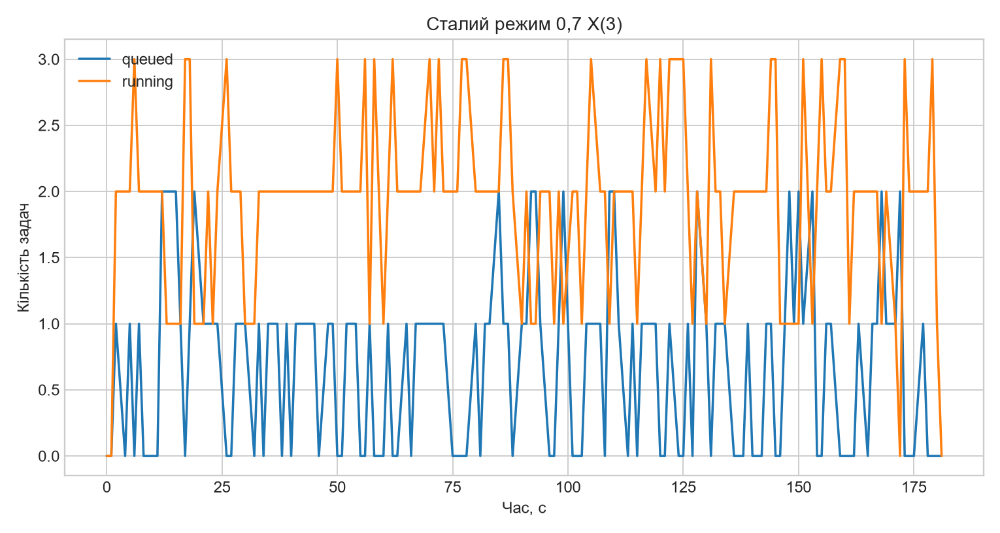
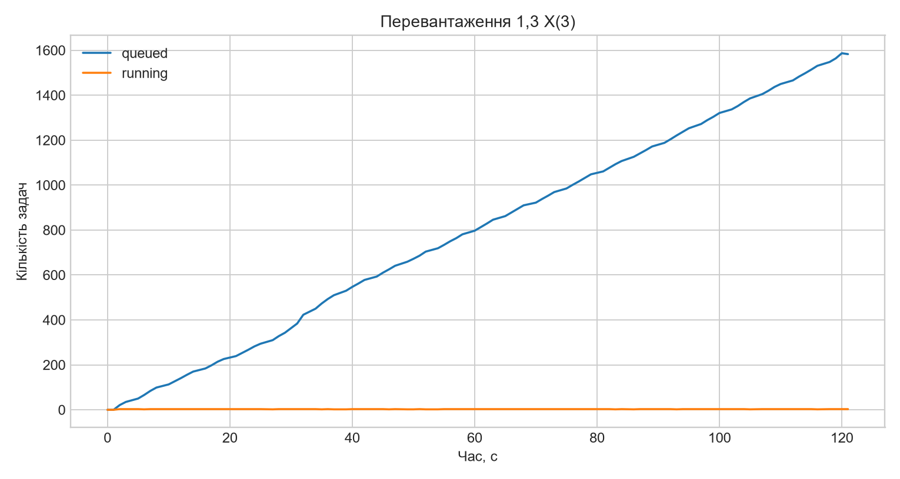

# Лабораторна робота № 4. Синхронізація пулу воркерів

**Дисципліна:** Високопродуктивні розподілені обчислювальні системи 
**Варіант:** 6  
**Основа:** Kubernetes-стенд лабораторної роботи № 3  
**Дата експериментів:** 8, 22 і 23 листопада 2026 року

## 1. Мета і параметри варіанта

Мета роботи — реалізувати чергу задач у PostgreSQL і пул окремих воркерів,
експериментально показати race condition наївного захоплення, усунути дублі
рядковим блокуванням, перевірити lease, heartbeat, fencing token,
ідемпотентність результату, масштабування, закон Літтла та зупинку за SIGTERM.

Для варіанта 6 використано `q_lo=0,01`, `q_hi=0,99`, `T_poll=100 мс`,
`L=15 с`, `R=3`, сценарій Ф3 і додаткову вимогу Д4. Зріз має розмір
`256×256`; worker працює без NumPy/Numba.

## 2. Реалізація

Міграція `lab4/migration.sql` додає `tasks` та `task_results`. У `tasks`
зберігаються стан, `record_id`, `seed`, `attempts`, `max_attempts=3`, `token`,
`lease_until`, worker і часові позначки; індекс створено за
`(status, created_at)`. `task_results.task_id` є первинним ключем.

Web API доповнено маршрутами:

- `POST /prescriptions/{id}/tasks` — HTTP 202 або 404;
- `GET /tasks/{id}` — стан і результат;
- `GET /tasks` — фільтр за статусом, `limit` і `offset`;
- `/metrics` — `tasks_queued` і `tasks_running`, оновлення кожні 5 с.

Worker має окремий образ і Deployment. Він отримує `WORKER_ID` через Downward
API, послідовно виконує HTTP fetch, гістограмну обробку та транзакційний store.
Метрики: `worker_tasks_total`, `worker_claims_total`,
`worker_task_duration_seconds` і `worker_tasks_in_flight`.

У штатному режимі захоплення виконується однією командою з
`FOR UPDATE SKIP LOCKED`. Під час claim збільшуються `attempts` і `token`,
lease продовжується кожні 5 с. Прострочені задачі повертаються в `queued`, а на
третій невдалій спробі — у `failed`. Завершення з умовою за token і
`INSERT ... ON CONFLICT DO NOTHING` виконуються однією транзакцією.

## 3. Калібрування одного воркера

Наскрізний smoke-тест завершив задачу й повернув детермінований JSON-результат.
Для серії з 20 задач середні тривалості за Prometheus становили:

| Крок | Середній час, с |
|---|---:|
| claim | 0,002041 |
| fetch | 0,008495 |
| process | 0,066495 |
| store | 0,010873 |

Отже, `t_io=0,019368 с`, `t_cpu=0,066495 с`. Оцінка з урахуванням середнього
очікування опитування:

\[
X_1^{estimate}=\frac{1}{t_{io}+t_{cpu}+T_{poll}/2}
=\frac{1}{0{,}019368+0{,}066495+0{,}05}=7{,}360\;tasks/s.
\]

## 4. Наївне захоплення і рядкові блокування

У кожній серії створено 300 задач із 100 задач/с на трьох workers. У наївному
режимі між `SELECT` і `UPDATE` немає штучної затримки. `n_dup` визначено двома
способами: за задачами з кількома рядками у `task_results` і за задачами з
кількома подіями `task_done` у журналах workers.

| Режим | T_poll, мс | n_dup за таблицею | D за таблицею | n_dup за логами | D за логами |
|---|---:|---:|---:|---:|---:|
| окремі `SELECT` та `UPDATE` | 100 | 22 | 0,073333 | 22 | 0,073333 |
| окремі `SELECT` та `UPDATE` | 1 | 23 | 0,076667 | 23 | 0,076667 |
| `FOR UPDATE SKIP LOCKED` | 1 | 0 | 0 | 0 | 0 |

В обох наївних серіях оцінки за таблицею і журналами збіглися. Навіть без
додаткової паузи між командами окремі `SELECT` та `UPDATE` не є атомарними й
дали дублі. Захоплення з `SKIP LOCKED` усунуло їх.

Для `FOR UPDATE` без `SKIP LOCKED` також отримано `n_dup=0`, `D=0` за
таблицею та журналами. Claim p99 дорівнював 0,004989 с, а точний приріст
`worker_claims_total{result="empty"}` за прогін — 6294. Зібрано 14 знімків
`pg_stat_activity`; середній інтервал між ними становив 0,994 с, максимальний
— 1,061 с. Найбільша кількість рядків з `wait_event_type='Lock'` дорівнювала
нулю. Це означає, що секундний sampler не зафіксував очікувань, але не
виключає блокувань, коротших за його дискретність.

## 5. Lease, heartbeat і fencing

У серії створено рівно 100 задач. У цьому kind/containerd команда
`kill -STOP 1` не зупинила PID 1, тому еквівалентне зависання виконано через
`ctr tasks pause/resume` для конкретного worker-контейнера. Штучні затримки
обробки не використовувалися.

На момент pause задача 1 мала `attempts=1`, `token=1` і належала
`worker-5566f5b8ff-4cbpf`. Через 30 с її перехопив
`worker-5566f5b8ff-bvf5b`: підсумкові значення — `attempts=2`, `token=2`.
Після resume старий worker записав `heartbeat_lost` та `fencing_rejected` з
`updated_rows=0`. У `task_results` для цієї задачі залишився один рядок.

## 6. Пропускна здатність і USL

Для кожного W перед запуском workers у черзі було 400 задач. `X(W)` обчислено
як 400, поділене на інтервал від першого `started_at` до останнього
`finished_at`. Упродовж цього інтервалу оброблялася попередньо заповнена черга;
порожні секунди до запуску workers до розрахунку не включалися.

| W | Активний інтервал, с | X(W), задач/с | SD посекундного X | C(W) | claim p99, с | DB tx/s | DB CPU, cores |
|---:|---:|---:|---:|---:|---:|---:|---:|
| 1 | 33,553 | 11,921 | 1,975 | 1,000 | 0,04237 | 73,985 | 0,0961 |
| 2 | 17,020 | 23,502 | 4,353 | 1,971 | 0,04005 | 87,243 | 0,1008 |
| 3 | 11,763 | 34,005 | 8,963 | 2,852 | 0,04049 | 121,066 | 0,1166 |

`DB tx/s` обчислено як сумарну швидкість підтверджених і скасованих
транзакцій PostgreSQL за хвилинним вікном Prometheus. `DB CPU` показує
середнє використання процесора контейнером PostgreSQL у CPU cores за тим
самим вікном. Використання CPU PostgreSQL зросло від 0,0961 до 0,1166 cores,
а швидкість транзакцій — від 73,985 до 121,066 за секунду.

За моделлю

\[
C(W)=\frac{W}{1+\sigma(W-1)+\kappa W(W-1)}
\]

необмежена апроксимація дала від'ємне `σ`, тому застосовано фізично допустиме
обмеження `σ≥0`. Отримано `σ=0`, `κ=0,008486`, `W*=10,86`. Модель побудована за трьома
значеннями `X(W)`, тому її слід розглядати як апроксимацію виміряної ділянки,
а не як перевірений прогноз для 11 workers.

Виміряне `X(1)=11,921` вище оцінки `7,360`, оскільки за непорожньої черги
worker не сплачує `T_poll/2` для кожної задачі: після store наступний claim
відбувається одразу.

## 7. Закон Літтла і профіль 1,3·X(3)

У steady-профілі `0,7·X(3)` цільова інтенсивність становила 23,804 задач/с,
а фактична за останні 120 с — `λ=23,8 задач/с`. Отримано `Wq=0,030441 с`,
отже `λWq=0,724503`. Виміряне щосекундне середнє `Lq=0,68`; розбіжність —
6,54%. За короткої черги похибка секундного семплювання залишається помітною:
`Lq` знімався раз на секунду, а `Wq` розраховано за часовими позначками задач.

Для другого профілю подано `1,3·X(3)=44,207 задач/с`. Наприкінці 120 с у
черзі залишилося 1583 задачі. `Wq` перших 100 задач дорівнював 0,561 с,
останніх 100 — 46,581 с, що підтверджує накопичення backlog.

## 8. Коректна зупинка

Під профілем `0,7·X(3)=23,804 задач/с` виконано rollout restart. Створено
і завершено 2856 задач; `failed=0`, `attempts>1=1`, задач із кількома
результатами — 0. У штатному прогоні поточні задачі завершилися раніше за
тайм-аут, тому обробники SIGTERM повернули до черги 0 задач.

Після SIGTERM окремий watchdog відраховує 25 с, що менше за
`terminationGracePeriodSeconds=30`. Якщо основний потік не завершив задачу,
watchdog через окреме підключення до БД виконує умовне повернення
`WHERE id=? AND token=? AND status='running'` і завершує процес з кодом 0.
Цю гілку перевірено unit-тестом із задачею у `held`: оновлено один рядок і
викликано `os._exit(0)`.

Коди завершення старих контейнерів знято безпосередньо з подій
`containerd /tasks/exit`. Для всіх трьох worker-контейнерів код дорівнює 0.
У protobuf JSON поле `exit_status` для нульового значення не виводиться, тому
парсер трактує наявну подію exit без цього поля як код 0. Відповідність pod,
container ID, файла подій і номера рядка збережено у
`step8_container_exit_codes.csv`.

## 9. FAIL_RATE і сценарій Ф3

Дві серії тривали по 300 с при `FAIL_RATE=0,15` та інтенсивності
`0,7·X(3)=23,804 задач/с`. Щоб стандартний наростаючий CrashLoopBackOff не
розтягнув більшість повторних спроб за межі профілю, на двох worker-вузлах
kind на час цих серій максимальний restart backoff обмежено 2 с. До і після
експерименту конфігурації перевірено; після завершення початкові файли
відновлено з копій. Під час drain `FAIL_RATE` не вимикався.

| Показник | baseline | Ф3, 10 seed=0 |
|---|---:|---:|
| створено | 7141 | 7141 |
| done після повного drain | 7115 | 7097 |
| failed після повного drain | 26 | 44, з них 10 poison |
| done на кінці 300 с | 828 | 942 |
| queued на кінці 300 с | 6302 | 6187 |
| максимальна сума рестартів | 171 | 169 |
| X протягом профілю, задач/с | 2,708 | 3,056 |
| p99 Wq звичайних задач, с | 2022,232 | 2147,221 |
| задач із кількома результатами | 0 | 0 |

Для порівняння використано пропускну здатність без падінь
`X(3)=34,005 задач/с`.

| Серія | X із FAIL_RATE, задач/с | X(3) без падінь, задач/с | Частка від X(3) | Зниження |
|---|---:|---:|---:|---:|
| baseline | 2,708 | 34,005 | 7,96% | 92,04% |
| Ф3, 10 seed=0 | 3,056 | 34,005 | 8,99% | 91,01% |

За `FAIL_RATE=0,15` пропускна здатність обох серій становила приблизно
8–9% від `X(3)` без падінь. У baseline вона зменшилася на 92,04%, а
в серії Ф3 — на 91,01%. Близькі результати двох серій показують, що основне
зниження пропускної здатності пов’язане з перезапусками workers після
вбудованих падінь, тоді як десять poison-задач не спричинили додаткового
помітного зниження X.

Перша poison-задача створена через 150,020 с, остання — через 150,397 с від
початку генерації. Усі десять завершилися зі `status=failed` та `attempts=3`;
час від створення до `failed` становив 1046,590–1046,959 с.

Для звичайних задач теоретично `P(attempts>1)=f=0,15`, а
`P(failed)=f³=0,003375`. Числове порівняння:

| Серія | attempts>1 | Очікування f | p-value | failed | Очікування f³ | p-value |
|---|---:|---:|---:|---:|---:|---:|
| baseline, n=7141 | 1101 (15,418%) | 1071,15 (15%) | 0,3201 | 26 (0,3641%) | 24,10 (0,3375%) | 0,6823 |
| Ф3 без poison, n=7131 | 1080 (15,145%) | 1069,65 (15%) | 0,7277 | 34 (0,4768%) | 24,07 (0,3375%) | 0,0513 |

Наведені p-value отримано точним двобічним біноміальним тестом. На рівні
`α=0,05` модель з імовірностями `f` та `f³` не відхиляється для жодного
показника. Для остаточних відмов у серії Ф3 результат граничний
(`p=0,0513`), тому його не слід трактувати як точний збіг із теоретичною
часткою. Poison-задачі до цього порівняння не включалися.

## 10. Додаткова вимога Д4

| Показник | batch 1 | batch 10 |
|---|---:|---:|
| X(3), задач/с | 34,005 | 33,598 |
| claim p99, с | 0,04049 | 0,03590 |
| повернуто після SIGTERM у backlog-прогоні | 0 | 11 |

У цій серії batch 10 дав `X(3)` на 1,20% менше, а claim p99 — на 11,33%
менше, ніж batch 1. Різниця пропускної здатності мала порівняно з її
посекундним розкидом, тому підвищення X від пакетного claim не підтверджено.
Ціна пакетного захоплення — більше задач, які worker утримує під час SIGTERM.
У backlog restart batch 10 повернув 11 задач; 20 задач мали `attempts>1`, але
`failed=0` і дублів результатів не було.

## 11. Дані та відтворюваність

Первинні CSV, JSON і журнали розміщено в `results/lab4/`, графіки — в
`images/lab4/`. Розгортання і сценарії знаходяться в `lab4/`, аналіз виконує
`analyze_lab4.py`. Усі числа в таблицях взято з CSV, JSON, SQL або Prometheus.
Секрети з `.env` до результатів не записувалися.

## 12. Висновки

Без штучної паузи наївне захоплення дало `D=0,073333` при 100 мс і
`D=0,076667` при 1 мс; оцінки за таблицею та журналами збіглися.
`FOR UPDATE SKIP LOCKED` і `FOR UPDATE` без `SKIP LOCKED` знизили D до
нуля. Lease і fencing не дозволили відновленому старому worker перезаписати
результат.

За інтервалом непорожньої черги отримано `X(1)=11,921`, `X(2)=23,502` і
`X(3)=34,005 задач/с`; апроксимація USL дала `σ=0`, `κ=0,008486` та
`W*=10,86`. У steady-профілі закон Літтла виконався з розбіжністю 6,54%, а
при `1,3·X(3)` черга зросла до 1583 задач. Watchdog обмежує завершення після
SIGTERM 25 секундами і повертає незавершену задачу лише за її token. У
fault-серіях точні біноміальні тести не відхилили ймовірності `f` та `f³`
на рівні `α=0,05`; для остаточних відмов у Ф3 результат був граничним
(`p=0,0513`). Усі десять poison-задач завершилися після трьох спроб. Batch 10 зменшив claim
p99 на 11,33%, але приросту пропускної здатності не дав і збільшив кількість
захоплених задач, які треба повернути під час SIGTERM.
