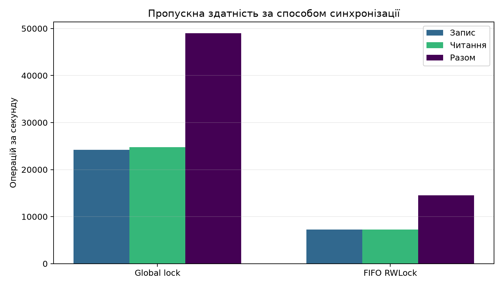
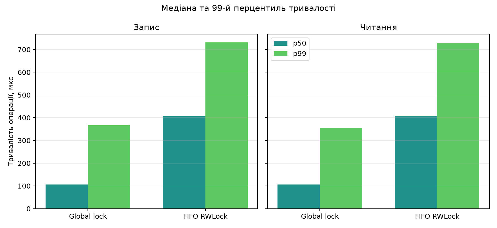
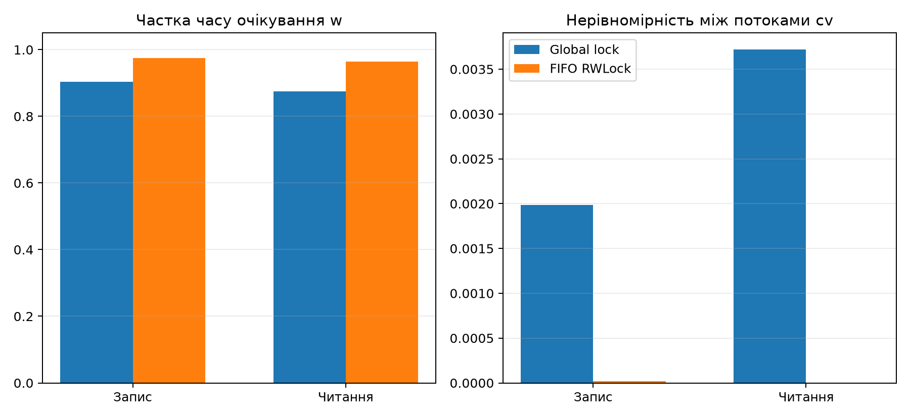
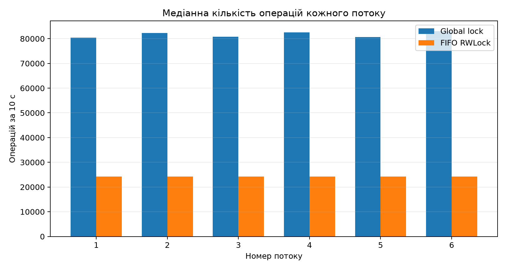

# Лабораторна робота № 5. Проєктування потокобезпечної структури даних

**Дисципліна:** Високопродуктивні розподілені обчислювальні системи

**Варіант:** 6

**Дата експерименту:** 23.11.2026

## 1. Мета і параметри варіанта

Мета роботи — реалізувати потокобезпечну структуру даних, виміряти доступ до
неї під одним глобальним замком і під замком читання-запису, а потім порівняти
пропускну здатність, тривалість операцій, очікування замка та рівномірність між
потоками.

Варіант 6 задає структуру С6 — кільцевий буфер останніх 1024 подій сервісу.
Операція запису `append(e)` додає подію, а операція читання `last(16)` повертає
не більше 16 останніх подій із номерами, що строго спадають. Стенд використовує
`n=6` потоків: потоки 1, 3 і 5 записують, а потоки 2, 4 і 6 читають. Отже,
`n_w=3` і `n_r=3`.

## 2. Реалізація

Буфер реалізовано як масив фіксованого розміру, індекс наступного запису,
поточний розмір і монотонний номер події. Після заповнення нова подія
перезаписує найстарішу. `last(16)` рухається від останнього записаного елемента
назад і повертає незмінний кортеж; поля структури під час читання не змінюються.

Перевірено два способи синхронізації:

- `GlobalMutex` використовує один `threading.Lock` для кожної операції читання
  і запису;
- `FifoRWLock` побудовано на `threading.Condition`. Кожне захоплення отримує
  монотонний ticket. Запити починають роботу в порядку ticket; послідовні
  читачі можуть бути активними разом, а писець починає роботу лише після виходу
  всіх попередніх читачів. Нові запити не обходять чергу, тому очікування обох
  ролей обмежене й голодування не виникає.

Спосіб синхронізації вибирається параметром `--mode global|rwlock|both`, а
окремий режим вимірювання `X_1` — параметром `--phase baseline`. Повний запуск
використовує `--mode both --phase both`.

Для кожної операції `t_call` фіксується безпосередньо перед захопленням замка,
`t_acq` — після успішного захоплення, а `t_ret` — після звільнення. Аргумент
події формується потоком до виклику `append`. Тривалість і час очікування
обчислюються за `perf_counter_ns()`. p50 і p99 визначаються методом nearest
rank окремо для кожної ролі. Після кожного прогону стенд перевіряє розмір,
цілісність кільця, неперервність номерів, спадний порядок `last(16)` і
незмінність стану після читання.

## 3. Стенд і методика експерименту

Вимірювання виконано в CPython 3.12.5 на Windows 10 build 19045. Система
повідомляє 12 логічних ядер і процесор `AMD64 Family 23 Model 96 Stepping 1`.
Кожен прогін мав 1 с прогріву та `D=10 с` вимірювання; кожен режим повторено
тричі. У таблицях наведено медіану трьох значень на рівні прогонів. Операції
йшли без штучних пауз. Для `X_1` один потік чергував запис і читання у
пропорції 3:3, тобто `write, read` тричі за цикл.

Означення швидкостей:

\[
X_w=\frac{N_w}{D},\qquad X_r=\frac{N_r}{D},\qquad X=X_w+X_r.
\]

Оскільки за означенням `X_1` має вимірюватися під тим самим замком, зафіксовано
два baseline-значення: `X_1(G)=270 068,2 оп/с` і
`X_1(RW)=191 756,2 оп/с`.

**Таблиця 1 — Стенд**

| n | n_w | n_r | Мова і версія | Логічних ядер | X_1, оп/с | Інваріанти після кроків 2 і 3 |
|---:|---:|---:|---|---:|---:|---|
| 6 | 3 | 3 | CPython 3.12.5 | 12 | G: 270 068,2; RW: 191 756,2 | Усі 6 основних прогони валідні; `last(16)` чистий |

## 4. Глобальний замок

**Таблиця 2 — Глобальний замок, медіана трьох прогонів**

| Роль | Операцій за 10 с | X, оп/с | p50, мкс | p99, мкс | Найбільший t_wait, мс | w | cv | t_cs, мкс |
|---|---:|---:|---:|---:|---:|---:|---:|---:|
| Запис | 241 828 | 24 182,8 | 106,7 | 367,2 | 14,5133 | 0,903739 | 0,001983 | 0,404520 |
| Читання | 247 889 | 24 788,9 | 106,5 | 355,9 | 13,7282 | 0,874798 | 0,003718 | 2,280194 |
| Разом | 489 717 | 48 971,7 | — | — | — | — | — | 1,342357* |

\* У рядку «Разом» наведено зважене
`t̄_cs=(3·t_cs,w+3·t_cs,r)/6`, а не тривалість окремої операції.

Однопотокові вимірювання дали межу глобального замка:

\[
\bar t_{cs}=1{,}342357\ \text{мкс},\qquad
\frac{1}{\bar t_{cs}}=744\ 958{,}3\ \text{оп/с}.
\]

Виміряне `X(G)=48 971,7 оп/с` не перевищує межу і становить 6,57 % від неї.
Межа є слабкою для цього стенду, бо не враховує планування потоків, GIL,
формування результату `last(16)`, виклики таймера та роботу поза критичною
секцією.

## 5. RWLock

**Таблиця 3 — FIFO RWLock, медіана трьох прогонів**

| Роль | Операцій за 10 с | X, оп/с | p50, мкс | p99, мкс | Найбільший t_wait, мс | w | cv |
|---|---:|---:|---:|---:|---:|---:|---:|
| Запис | 72 589 | 7 258,9 | 407,2 | 730,8 | 11,0422 | 0,974601 | 0,0000195 |
| Читання | 72 588 | 7 258,8 | 407,6 | 730,3 | 10,9996 | 0,964913 | 0,0000000 |
| Разом | 145 177 | 14 517,7 | — | — | — | — | — |

FIFO-політика практично вирівняла кількість операцій потоків, але кожне
захоплення RWLock потребує входу до `Condition`, роботи з ticket і
`notify_all()`. Для коротких операцій С6 ці витрати перевищили користь від
спільної фази читачів. Крім того, GIL не дає чистому Python-коду читачів
виконуватися паралельно на кількох ядрах.





## 6. Рівномірність між потоками

**Таблиця 4 — Медіанна кількість операцій потоку за 10 с**

| Потік | Роль | Глобальний замок | RWLock |
|---:|---|---:|---:|
| 1 | запис | 80 396 | 24 197 |
| 2 | читання | 82 300 | 24 196 |
| 3 | запис | 80 766 | 24 196 |
| 4 | читання | 82 551 | 24 196 |
| 5 | запис | 80 666 | 24 196 |
| 6 | читання | 83 038 | 24 196 |

З глобальним замком `cv` дорівнював 0,001983 для запису і 0,003718 для
читання. З FIFO RWLock ці значення зменшилися до 0,0000195 та 0. Ticket-порядок
покращив рівномірність, але не компенсував накладні витрати синхронізації.





## 7. Прискорення й ефективність

**Таблиця 5 — Метрики прискорення**

| Метрика | Формула | Значення |
|---|---|---:|
| S(6), глобальний замок | X(G) / X_1(G) | 0,181331 |
| E(6), глобальний замок | S(6) / 6 | 0,030222 |
| S(6), RWLock | X(RW) / X_1(RW) | 0,075709 |
| E(6), RWLock | S(6) / 6 | 0,012618 |
| S_w | X_w(RW) / X_w(G) | 0,300168 |
| S_r | X_r(RW) / X_r(G) | 0,292825 |
| S_Σ | X(RW) / X(G) | 0,296451 |
| ρ, завантаженість глобального замка | X(G) · t̄_cs | 0,065738 |

Обидва `S(6)` менші за 1: для цього CPU-bound мікротесту один Python-потік
швидший за шість конкурентних потоків. Це не помилка формули, а виміряний
наслідок GIL, перемикань і синхронізації. Заміна глобального замка на RWLock
зменшила швидкість запису до 30,02 %, читання — до 29,28 %, а сумарну — до
29,65 % від відповідних значень глобального замка.

## 8. Порівняння доступу до даних

**Таблиця 6 — Порівняння доступу, медіана трьох прогонів**

Кожен показник спочатку обчислено для окремого прогону, а потім узято його
медіану. Тому, наприклад, медіана `h` або `φ` може трохи відрізнятися від
відношення вже округлених медіан p99/p50 чи X ролі/X.

| Показник | G: запис | G: читання | RW: запис | RW: читання | RW/G: запис | RW/G: читання |
|---|---:|---:|---:|---:|---:|---:|
| X, оп/с | 24 182,8 | 24 788,9 | 7 258,9 | 7 258,8 | 0,300168 | 0,292825 |
| x, оп/с на потік ролі | 8 060,93 | 8 262,97 | 2 419,63 | 2 419,60 | 0,300168 | 0,292825 |
| p50, мкс | 106,7 | 106,5 | 407,2 | 407,6 | 3,816307 | 3,827230 |
| p99, мкс | 367,2 | 355,9 | 730,8 | 730,3 | 1,990196 | 2,051981 |
| h = p99 / p50 | 3,441425 | 3,341784 | 1,794695 | 1,791708 | 0,521498 | 0,536153 |
| Найбільший t_wait, мс | 14,5133 | 13,7282 | 11,0422 | 10,9996 | 0,760833 | 0,801241 |
| w | 0,903739 | 0,874798 | 0,974601 | 0,964913 | 1,078410 | 1,103013 |
| cv | 0,001983 | 0,003718 | 0,0000195 | 0 | 0,009825 | 0 |
| φ | 0,495541 | 0,504459 | 0,500003 | 0,499997 | 1,009005 | 0,991155 |

Абсолютні p50 і p99 з RWLock зросли для обох ролей. Менше `h` у цьому режимі
не означає меншу затримку: p50 зріс приблизно у 3,82 раза, а p99 — у 1,99–2,05
раза, тому їхнє відношення механічно зменшилося. Частка очікування `w` зросла,
хоча медіана найбільшого очікування зменшилася. Жодне максимальне очікування
не було порівнянним із `D=10 с`, отже ознак голодування писця немає. Головна
перевага FIFO RWLock у цьому експерименті — майже нульовий `cv`, тобто
рівномірний доступ потоків. Частки ролей близькі до 0,5 в обох режимах.

## 9. Дані, відтворюваність і обмеження

Первинний машинозчитуваний результат з усіма показниками кожного прогону
збережено в `results/lab5/raw_results.json`. `runs.csv` містить ті самі
run-level метрики у табличній формі; `summary.json`, `summary.csv`,
`comparison.csv` і `thread_counts.csv` отримано скриптом `analyze_lab5.py`.
Надруковані після кожного прогону показники збережено в
`benchmark_console.log`. Перевірки кількості прогонів, параметрів, інваріантів
і формул записані в `analysis_checks.json`. Повний запуск і аналіз:

```powershell
python -m unittest -v lab5.test_benchmark
python -m lab5.benchmark --mode both --phase both --output results\lab5\raw_results.json 2>&1 |
    Tee-Object -FilePath results\lab5\benchmark_console.log
python analyze_lab5.py
Get-Content results\lab5\analysis_checks.json
```

Результати характеризують саме CPython 3.12.5 і вибрану FIFO-реалізацію
RWLock, а не всі мови чи політики RWLock. Під час прогонів не запускалося інше
навантаження лабораторної, однак фонові служби Windows і вже запущений Docker
не зупинялися, тому стенд не був апаратно ізольованим. Три повтори дають
медіану, але не довірчий інтервал. Масиви тривалостей операцій зберігалися в
пам'яті до точного обчислення nearest-rank перцентилів; у JSON записані
run-level результати, кількість samples, суми тривалості, очікування й утримання
замка, а не багатомільйонні масиви окремих спостережень.

## 10. Використання генеративної моделі

Генеративну модель використано як допоміжний інструмент під час аналізу методичних вимог, 
проєктування стенду, розроблення тестів, перевірки формул і підготовки скрипту аналізу, а також для косметичного
редагування звіту. Усі числові результати отримано під час реального локального запуску; синтетичні вимірювання та 
припущення замість фактичних даних не використовувалися.

## 11. Висновки

Для варіанта 6 реалізовано кільцевий буфер на 1024 події та перевірено його
інваріанти в усіх прогонах. Глобальний замок забезпечив 48 971,7 оп/с, тоді як
FIFO RWLock — 14 517,7 оп/с, тобто 29,65 % від результату глобального замка.
RWLock збільшив p50 приблизно у 3,82 раза й частку часу очікування для обох
ролей, тому не прискорив короткі операції С6 у CPython. Водночас ticket-політика
дала майже ідеальну рівномірність між потоками: `cv=0,0000195` для запису і 0
для читання, без ознак голодування. Отже, для цього стенду простий глобальний
замок має кращу швидкість доступу, а FIFO RWLock — кращу справедливість.
