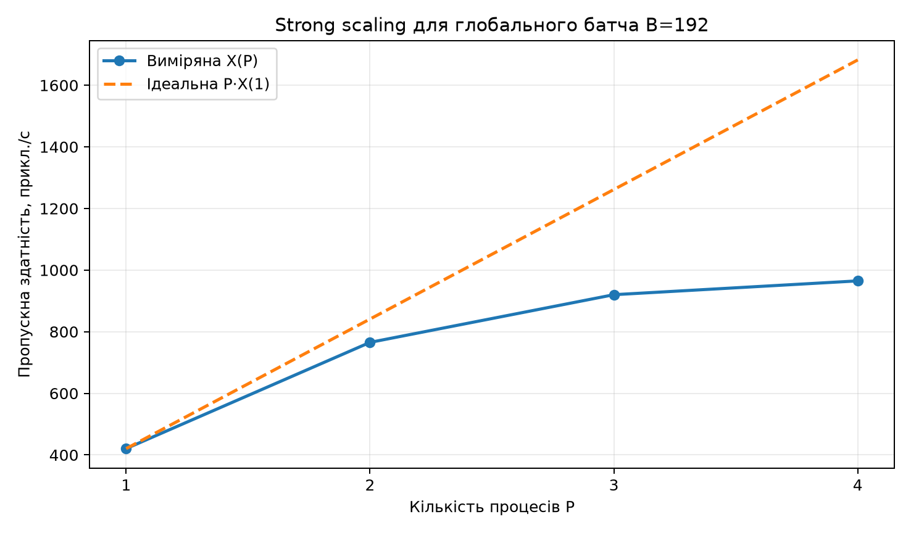
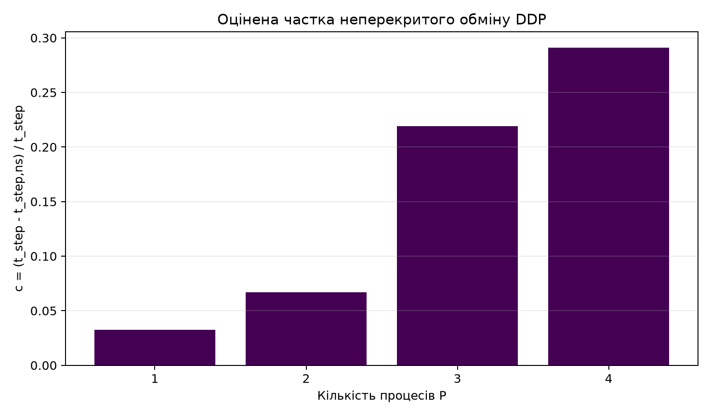
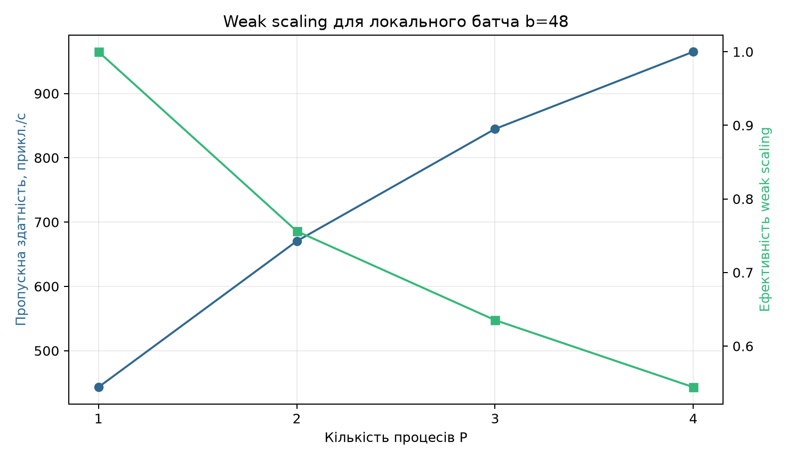
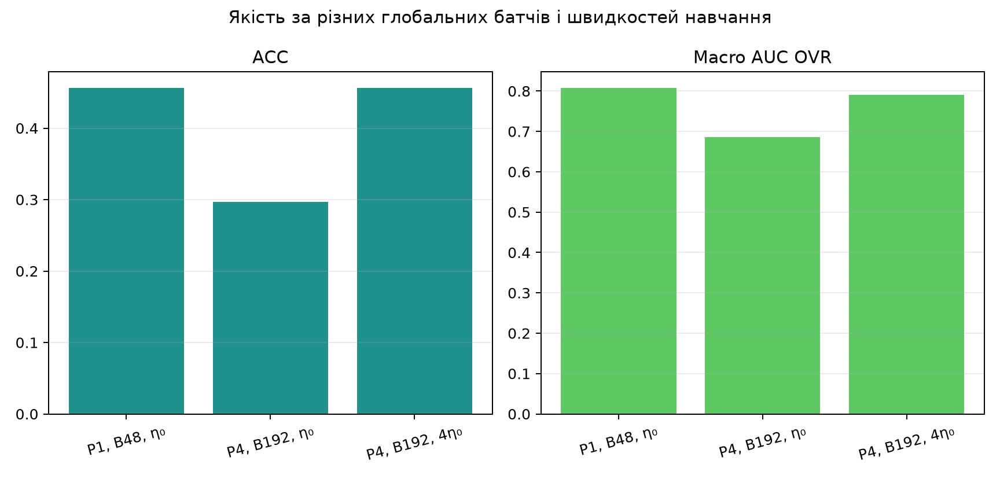
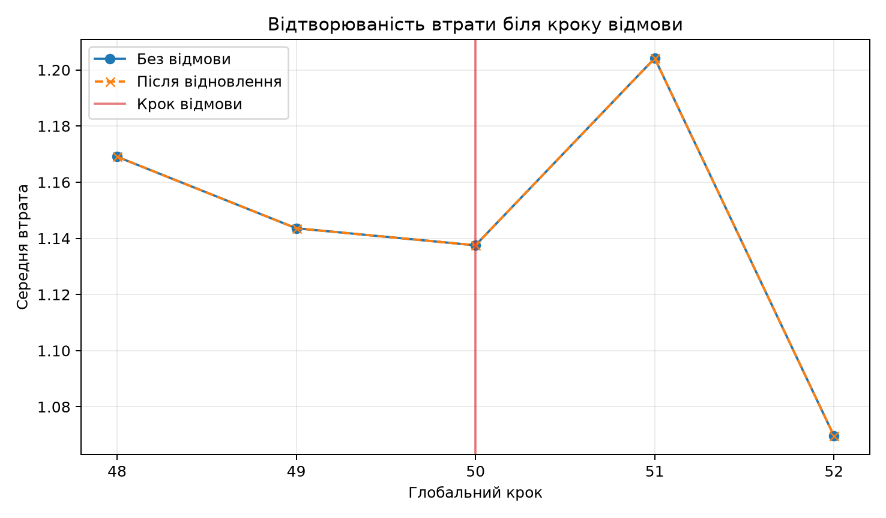

# Лабораторна робота № 6. Розподілене навчання нейромережі за даними на CPU

**Дисципліна:** Високопродуктивні розподілені обчислювальні системи  
**Варіант:** 6  
**Дата експерименту:** 23.11.2026

## 1. Мета і параметри варіанта

Мета роботи — реалізувати синхронне навчання згорткової нейромережі за схемою
паралелізму за даними, перевірити еквівалентність ручного усереднення
градієнтів, порівняти ручний `all-reduce` з `DistributedDataParallel`, виміряти
strong і weak scaling, дослідити лінійне масштабування швидкості навчання та
перевірити відновлення після аварійного завершення одного процесу.

Варіант 6 задає датасет `Д6` — OCTMNIST, ширину мережі `Ш3`,
`P_max=4`, глобальний батч `B=192`, інтервал контрольних точок `K_c=20` і
крок відмови `s_f=50`. Для OCTMNIST `K=4`, `C=1`, а для ширини `Ш3`
`c1=64`, `c2=128`, `h=512`. Навчальна вибірка містила перші `N=7000`
прикладів `train`, тестова — всі 1000 прикладів `test`.

## 2. Стенд і реалізація

Експерименти виконано в окремому Docker-образі для CPU. Сторонні
kind-контейнери під час фінальної серії були тимчасово призупинені; volumes і
PVC не видалялися. Для всіх режимів задано

\[
n_{th}=\left\lfloor\frac{C_{phys}}{P_{max}}\right\rfloor
=\left\lfloor\frac{6}{4}\right\rfloor=1.
\]

**Таблиця 1 — Стенд**

| Процесор | Фізичних ядер | Логічних ядер | Пам’ять | ОС і контейнерне середовище | Python | PyTorch | n_th |
|---|---:|---:|---:|---|---|---|---:|
| AMD Ryzen 5 4600H with Radeon Graphics | 6 | 12 | 16,506 ГБ | Windows 10 Pro 19045; Docker Engine 29.8.2; Linux/WSL2 kernel 6.18.58.1 | 3.12.15 | 2.9.1+cpu | 1 |

Модель містить два згорткові шари з `ReLU` і `MaxPool2d(2)`, повнозв’язний
прихований шар та вихідний шар. BatchNorm не використовується. Кількість
параметрів перевірено і формулою, і сумою `p.numel()`:

\[
\begin{aligned}
n_{params}={}&9\cdot1\cdot64+64+9\cdot64\cdot128+128\\
&+49\cdot128\cdot512+512+512\cdot4+4\\
={}&3\ 288\ 324,\\
M={}&4n_{params}=13\ 153\ 296\ \text{байтів}=12{,}543961\ \text{MiB}.
\end{aligned}
\]

**Таблиця 2 — Дані та модель**

| Датасет | K | C | c1 / c2 / h | n_params | M, MiB | N | B | P_max |
|---|---:|---:|---|---:|---:|---:|---:|---:|
| OCTMNIST | 4 | 1 | 64 / 128 / 512 | 3 288 324 | 12,543961 | 7000 | 192 | 4 |

Зображення перетворювалися з `uint8` у `float32`, форма ставала
`(N,1,28,28)`, а значення нормалізувалися до `[-1;1]`. Використано SGD з
momentum 0,9, базовою швидкістю `η₀=0,02` і зерном 0. Для gloo явно задано
`GLOO_SOCKET_IFNAME=lo`.

## 3. Методика вимірювання

Кожен швидкісний прогін мав 10 кроків прогріву і 50 вимірюваних кроків.
`t_step` — медіана 50 часів процесу 0, а пропускна здатність обчислювалася з
повної тривалості вимірюваного інтервалу:

\[
X=\frac{50B}{t}.
\]

Для DDP окремий прогін виконував backward у `model.no_sync()`. Неперекриту
частину обміну оцінено як

\[
t_{comm,exp}=t_{step}-t_{step,ns},\qquad
c=\frac{t_{comm,exp}}{t_{step}}.
\]

У strong scaling глобальний батч дорівнював 192, у weak scaling локальний батч
кожного процесу дорівнював 48. Навчання для оцінювання якості тривало три
епохи. ACC і macro AUC OVR обчислювалися на всій тестовій частині.

## 4. Ручна синхронізація і DDP

Перед ручним навчанням параметри rank 0 розсилалися через `broadcast`. Після
`backward()` для кожного з восьми тензорів параметрів виконувався `all_reduce`
із діленням градієнта на `P`.

На першому батчі rank `r` отримував індекси `r, r+4, ...`. Найбільше
відношення `max|g-ḡ|/max|g|` дорівнювало `5,404025·10⁻⁶`, а найбільша
абсолютна різниця — `7,078052·10⁻⁸`. Це відповідає очікуваній похибці зміни
порядку додавання `float32`. Після 50 кроків різниця між найбільшою і
найменшою сумою ваг чотирьох процесів дорівнювала нулю.

**Таблиця 3 — Синхронізація градієнтів**

| Режим | t_step, мс | Час обміну, мс | Частка кроку в обміні | X, прикл./с |
|---|---:|---:|---:|---:|
| 1 процес, B=192 | 477,930 | 0 | 0 | 392,121 |
| 4 процеси, ручний all-reduce | 214,604 | 65,119 | 0,303436 | 883,808 |
| 4 процеси, DDP | 195,336 | 56,873 | 0,291157 | 964,950 |
| 4 процеси, DDP, no_sync | 138,462 | 0 | 0 | 1361,347 |

**Таблиця 4 — Еквівалентність і якість базових режимів**

| max\|g−ḡ\| / max\|g\| | Різниця сум ваг після 50 кроків | ACC, 1 процес | ACC, DDP P=4 | AUC, 1 процес | AUC, DDP P=4 |
|---:|---:|---:|---:|---:|---:|
| 5,404025·10⁻⁶ | 0 | 0,295 | 0,297 | 0,676507 | 0,685841 |

DDP скоротив медіану кроку відносно ручної синхронізації на 19,268 мс і
підвищив `X` на 9,18 %. Оцінена неперекрита частина обміну також зменшилася з
65,119 до 56,873 мс.

## 5. Strong scaling

**Таблиця 5 — Strong scaling, B=192**

| P | b | t_step, мс | t_step,ns, мс | X, прикл./с | S | E | e | c |
|---:|---:|---:|---:|---:|---:|---:|---:|---:|
| 1 | 192 | 450,796 | 436,176 | 420,526 | 1,000000 | 1,000000 | — | 0,032432 |
| 2 | 96 | 246,624 | 230,173 | 765,324 | 1,819924 | 0,909962 | 0,098947 | 0,066702 |
| 3 | 64 | 205,760 | 160,634 | 920,101 | 2,187978 | 0,729326 | 0,185564 | 0,219317 |
| 4 | 48 | 195,336 | 138,462 | 964,950 | 2,294628 | 0,573657 | 0,247734 | 0,291157 |



Від `P=1` до `P=4` пропускна здатність зросла у 2,295 раза, але ефективність
знизилася до 0,574. Зростання `e(P)` і `c(P)` показує, що додавання процесів
збільшує частку синхронізації: при `P=4` неперекритий обмін займав приблизно
29,12 % медіанного кроку.



## 6. Weak scaling

**Таблиця 6 — Weak scaling, b=48**

| P | B_P | t_step, мс | X, прикл./с | S_w | E_w |
|---:|---:|---:|---:|---:|---:|
| 1 | 48 | 107,177 | 443,294 | 1,000000 | 1,000000 |
| 2 | 96 | 139,676 | 670,406 | 1,512329 | 0,756164 |
| 3 | 144 | 163,677 | 844,868 | 1,905886 | 0,635295 |
| 4 | 192 | 195,336 | 964,950 | 2,176772 | 0,544193 |



За сталого локального батча обсяг обчислень на процес не зменшувався, але час
кроку зріс від 107,177 до 195,336 мс. Тому `X` збільшився у 2,177 раза замість
ідеальних чотирьох, а `E_w(4)` становила 0,544.

## 7. Якість за різних глобальних батчів

Для `P=1, B=48` виконано `floor(7000/48)·3=435` кроків. Для `P=4`,
`DistributedSampler` давав 1750 прикладів на процес, тому локальний
`DataLoader` виконував `floor(1750/48)·3=108` кроків. Лінійне правило задавало

\[
\eta_P=\eta_0P_{max}=0{,}02\cdot4=0{,}08.
\]

**Таблиця 7 — Якість після трьох епох**

| Режим | B_P | η | Кроків | ACC | AUC | Найбільша втрата останньої епохи |
|---|---:|---:|---:|---:|---:|---:|
| P=1 | 48 | 0,02 | 435 | 0,456 | 0,807195 | 1,280982 |
| P=4 | 192 | 0,02 | 108 | 0,297 | 0,685841 | 1,253849 |
| P=4, лінійне правило | 192 | 0,08 | 108 | 0,456 | 0,791172 | 1,037538 |



За незмінної `η₀` великий глобальний батч отримав у чотири рази менше оновлень
і показав гіршу якість. Лінійне збільшення швидкості навчання не спричинило
розходження: ACC зросла від 0,297 до 0,456 і зрівнялася з режимом `B=48`, хоча
AUC залишилася меншою на 0,016023.

## 8. Відмова і відновлення

Rank 0 атомарно записував `ckpt.tmp` і перейменовував його на `ckpt.pt` кожні
20 кроків. На початку кроку 50 rank 3 створив файл-позначку і завершився через
`os._exit(1)`. `torchrun --max-restarts=1` зупинив решту процесів і запустив
групу повторно. Статичний TCPStore використовував окремий `PrefixStore` для
кожного `TORCHELASTIC_RESTART_COUNT`, щоб нова група не прочитала endpoint-и
попередньої gloo-генерації. Перед повторним `init_process_group` виконувалася
5-секундна пауза; вона входить до `t_lost`.

**Таблиця 8 — Параметри відмови і відновлення**

| K_c | s_f | Остання контрольна точка | Повторно виконано кроків | Перший крок після відновлення | t_lost, с |
|---:|---:|---:|---:|---:|---:|
| 20 | 50 | 40 | 9 | 41 | 13,355105 |

Від запису checkpoint до відмови минуло 1,773378 с, а від відмови до завершення
першого відновленого кроку — 11,581727 с. Кількість повторно виконаних кроків
дорівнює `49−40=9`.

**Таблиця 9 — Втрата біля кроку відмови**

| Прогін | 48 | 49 | 50 | 51 | 52 | ACC після 3 епох |
|---|---:|---:|---:|---:|---:|---:|
| З відмовою | 1,169069886 | 1,143580735 | 1,137521982 | 1,204154134 | 1,069636881 | 0,297 |
| Без відмови | 1,169069886 | 1,143580765 | 1,137522012 | 1,204154164 | 1,069636911 | 0,297 |

Найбільша абсолютна різниця loss у вікні 48–52 становила
`2,980232·10⁻⁸`, а ACC збіглася точно. Додатково зафіксовано AUC 0,686001 з
відмовою і 0,685841 без відмови; різниця 0,000160 не входить до заданого
критерію порівняння ACC.



## 9. Обмеження експерименту

- Для кожної конфігурації виконано одну серію з 50 вимірюваних кроків; міжсерійну
  дисперсію не оцінювали.
- Вимірювання виконано всередині Docker Desktop/WSL2, тому абсолютні часи
  залежать від планувальника Windows і контейнерної віртуалізації.
- `t_comm,exp` є різницею двох окремих прогонів DDP і `no_sync`; вона включає
  шум запуску та накладні витрати reducer, а не є прямим профілюванням кожної
  колективної операції.

## 10. Дані та відтворюваність

Датасет `octmnist.npz` завантажено з офіційного архіву MedMNIST v3.0. Його
SHA-256 —
`2f909b7563c0279881a5d51c85a64833f3d4e42eace52b43ac2f22d15ff24986`.
Первинні JSON розташовано у `results/lab6/raw/`, повні консолі — у
`results/lab6/logs/`, зведені CSV і машинні перевірки — у `results/lab6/`.
Повний запуск у PowerShell:

```powershell
Set-ExecutionPolicy -Scope Process Bypass
.\lab6\run.ps1 -PauseKind
```

`results/lab6/analysis_checks.json` містить `passed=true` для всіх ключових
вимог.

## 11. Висновки

Ручне усереднення градієнтів відтворило однопроцесний градієнт із максимальною
відносною похибкою `5,404·10⁻⁶`, а ваги чотирьох процесів після 50 кроків
залишилися однаковими. DDP був швидшим за ручний `all-reduce`: 964,950 проти
883,808 прикл./с при `P=4`.

Strong scaling дав прискорення 2,295 і ефективність 0,574 на чотирьох процесах;
weak scaling — масштабоване прискорення 2,177 та ефективність 0,544. Обмеженням
стала частка неперекритого обміну, яка для `P=4` зросла до 29,12 % кроку.

Лінійне збільшення `η` від 0,02 до 0,08 компенсувало меншу кількість оновлень
великого батча за ACC без розходження навчання. Після аварії rank 3 навчання
відновилося з checkpoint кроку 40, повторило дев’ять кроків і зберегло loss у
вікні 48–52 з похибкою не більш як `2,98·10⁻⁸` та ту саму ACC 0,297.
